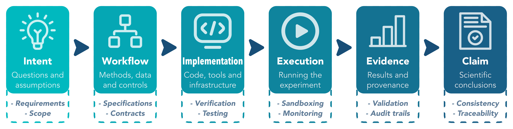

# Awesome SE4AISci

A curated list of papers, systems, benchmarks and resources on **Software Engineering for AI-Driven Science (SE4AISci)**: assuring the scientific process, not only the software that implements it.

## What is SE4AISci

AI is beginning to do science, not just support it. Software can now help choose methods, run experiments, interpret evidence and formulate scientific claims.

**SE4AISci** studies how software engineering can help make these scientific processes more explicit, checkable and traceable. Its organising framework is the **Scientific Assurance Chain**:

<em>Intent &rarr; Workflow &rarr; Implementation &rarr; Execution &rarr; Evidence &rarr; Claim</em>

Correct code is necessary, but trustworthy scientific claims require much more.

## The Scientific Assurance Chain

The chain captures the path from a scientific question to the claim ultimately produced from it. Each stage creates a different assurance problem, and failures can propagate even when later software behaves correctly.

The sections below organise related work around three questions:

- **Where it breaks** — documented failures in AI-driven scientific workflows.
- **Existing foundations** — SE and scientific-computing techniques that could be adapted.
- **SE4AISci work** — research directly targeting these assurance problems.

| Stage | What is assured | SE techniques |
|---|---|---|
| **Intent** | The scientific question, its assumptions and scope | Requirements engineering; scope and traceability |
| **Workflow** | The experimental procedure: methods, data and controls | Executable workflow specifications; methodological contracts; provenance |
| **Implementation** | The code, tools and infrastructure that realise the procedure | Integration testing; executable experiment requirements; specification-to-code traceability |
| **Execution** | Running the experiment inside a concrete environment and its boundaries | Sandboxing; capability restrictions; resource quotas; runtime monitoring |
| **Evidence** | The results and their provenance: what a run actually produced | Input validation; uncertainty tracking; provenance linking values to their source |
| **Claim** | The scientific conclusion drawn from the evidence | Evidence-to-claim traceability; automated consistency checks |

## Contents

- [Scientific Assurance Chain](#scientific-assurance-chain)
  - [Cross-cutting failures](#cross-cutting-failures)
  - [Intent](#intent)
  - [Workflow](#workflow)
  - [Implementation](#implementation)
  - [Execution](#execution)
  - [Evidence](#evidence)
  - [Claim](#claim)
- [Scientific Agents](#scientific-agents)
  - [Surveys, roadmaps and perspectives](#surveys-roadmaps-and-perspectives)
  - [Metascience and policy](#metascience-and-policy)
  - [End-to-end AI scientists](#end-to-end-ai-scientists)
  - [Co-scientists and hypothesis generation](#co-scientists-and-hypothesis-generation)
  - [Multi-agent labs and discovery engines](#multi-agent-labs-and-discovery-engines)
  - [Domain-specific agents](#domain-specific-agents)
  - [Self-driving laboratories and robot scientists](#self-driving-laboratories-and-robot-scientists)
  - [Agent-ready scientific software](#agent-ready-scientific-software)
- [Benchmarks and Evaluation](#benchmarks-and-evaluation)
  - [Paper and result reproduction](#paper-and-result-reproduction)
  - [Experiment design and end-to-end research](#experiment-design-and-end-to-end-research)
  - [Scientific coding](#scientific-coding)
  - [Data-driven discovery and analysis](#data-driven-discovery-and-analysis)
  - [Laboratory, protocol and ideation](#laboratory-protocol-and-ideation)
  - [Evaluation methodology](#evaluation-methodology)
- [Foundations and Related Areas](#foundations-and-related-areas)
  - [SE4Science and research software engineering](#se4science-and-research-software-engineering)
  - [AI for research software engineering](#ai-for-research-software-engineering)
  - [Software errors that damaged science](#software-errors-that-damaged-science)
  - [Reproducibility, provenance and scientific workflows](#reproducibility-provenance-and-scientific-workflows)
  - [SE for ML-based systems and LLM4SE](#se-for-ml-based-systems-and-llm4se)
  - [Scientific software](#scientific-software)
  - [Scientific software usage and influence](#scientific-software-usage-and-influence)
  - [Venues and communities](#venues-and-communities)
  - [Related awesome lists](#related-awesome-lists)
- [Contributing](#contributing)
- [License](#license)

## Scientific Assurance Chain

### Cross-cutting failures

- AI scientists produce results without reasoning scientifically (arXiv 2026) [[paper]](https://arxiv.org/abs/2604.18805)
- Real Science Is Harder Than Benchmarks: Evaluating Advanced AI Frameworks on Published Studies. I. (bioRxiv 2026) [[paper]](https://doi.org/10.64898/2026.06.24.734302)
- The more you automate, the less you see: Hidden pitfalls of autonomous AI scientists (PNAS 2026) [[paper]](https://doi.org/10.1073/pnas.2610214123)
- Why LLMs Aren't Scientists Yet: Lessons from Four Autonomous Research Attempts (arXiv 2026) [[paper]](https://arxiv.org/abs/2601.03315) [[code]](https://github.com/Lossfunk/ai-scientist-artefacts-v1)
- AI Scientists Fail Without Strong Implementation Capability (arXiv 2025) [[paper]](https://arxiv.org/abs/2506.01372)
- Evaluating Sakana's AI Scientist: Bold Claims, Mixed Results, and a Promising Future? (ACM SIGIR Forum 2025) [[paper]](https://doi.org/10.1145/3769733.3769747)

### Intent

**Where it breaks**

- Quantifying Overclaiming Propensity in Frontier LLM Agents (arXiv 2026) [[paper]](https://arxiv.org/abs/2609.20812)
- AI mirrors experimental science to uncover a mechanism of gene transfer crucial to bacterial evolution (Cell 2025) [[paper]](https://doi.org/10.1016/j.cell.2025.08.018)
- Technical Report: Evaluating Goal Drift in Language Model Agents (arXiv 2025) [[paper]](https://arxiv.org/abs/2505.02709)

**Engineering responses**

- An AI Scientist that Doesn't Drift: Taste, Structure, and Falsifiable Findings in a Quadruped Navigation Research Loop (arXiv 2026) [[paper]](https://arxiv.org/abs/2608.07542)
- Exploring the Garden of Forking Paths in Empirical Software Engineering Research: A Multiverse Analysis (ACM TOSEM 2026) [[paper]](https://doi.org/10.1145/3799711)
- Many AI analysts, one dataset: Navigating the agentic data science multiverse (PNAS 2026) [[paper]](https://doi.org/10.1073/pnas.2606495123)
- Mitigating LLM-based p-Hacking by Preregistering for the Next LLM (arXiv 2026) [[paper]](https://arxiv.org/abs/2606.27687)
- Nonstandard Errors in AI Agents (arXiv 2026) [[paper]](https://arxiv.org/abs/2603.16744)
- Preregistration for Experiments with AI Agents (arXiv 2026) [[paper]](https://arxiv.org/abs/2606.11217)
- RDoFlow: Automatically assessing under-specified statistical analyses in HCI (IUI 2026) [[paper]](https://doi.org/10.1145/3742413.3789160)
- The Agentic Garden of Forking Paths (arXiv 2026) [[paper]](https://arxiv.org/abs/2607.01507)
- Toward Auditable AI Scientists: A Hypothesis Evolution Protocol for LLM Agents (arXiv 2026) [[paper]](https://arxiv.org/abs/2607.09195)
- rTisane: Externalizing conceptual models for data analysis prompts reconsideration of domain assumptions and facilitates statistical modeling (CHI 2024) [[paper]](https://doi.org/10.1145/3613904.3642267) [[code]](https://github.com/tea-lang-org/rTisane)
- Hypothesis Formalization: Empirical Findings, Software Limitations, and Design Implications (ACM TOCHI 2022) [[paper]](https://doi.org/10.1145/3476980)
- Tisane: Authoring Statistical Models via Formal Reasoning from Conceptual and Data Relationships (CHI 2022) [[paper]](https://doi.org/10.1145/3491102.3501888) [[code]](https://github.com/tea-lang-org/tisane)
- Specification curve analysis (Nature Human Behaviour 2020) [[paper]](https://doi.org/10.1038/s41562-020-0912-z)
- Variability in the analysis of a single neuroimaging dataset by many teams (Nature 2020) [[paper]](https://doi.org/10.1038/s41586-020-2314-9)
- Tea: A High-level Language and Runtime System for Automating Statistical Analysis (UIST 2019) [[paper]](https://doi.org/10.1145/3332165.3347940) [[code]](https://github.com/tea-lang-org/tea-lang)
- Many Analysts, One Data Set: Making Transparent How Variations in Analytic Choices Affect Results (Advances in Methods and Practices in Psychological Science 2018) [[paper]](https://doi.org/10.1177/2515245917747646)
- The preregistration revolution (PNAS 2018) [[paper]](https://doi.org/10.1073/pnas.1708274114)
- Guidelines for the Content of Statistical Analysis Plans in Clinical Trials (JAMA 2017) [[paper]](https://doi.org/10.1001/jama.2017.18556)

### Workflow

**Where it breaks**

- Autoresearch with Coding Agents: Generalizers and Metric-Maximizers on Quran Recitation Data (arXiv 2026) [[paper]](https://arxiv.org/abs/2607.18064)
- Beneath the Diff: Diagnosing and Mitigating Algorithmic Mode Collapse in Code-Level Autonomous Research Loops (EMNLP 2026) [[paper]](https://arxiv.org/abs/2609.00077) [[code]](https://github.com/BokwaiHo/arl-mode-collapse)
- Can Coding Agents Reproduce Findings in Computational Materials Science? (COLM 2026) [[paper]](https://arxiv.org/abs/2605.00803)
- Likelihood Hacking in Probabilistic Program Synthesis (UAI 2026) [[paper]](https://arxiv.org/abs/2603.24126)
- Large Language Model Hacking: Quantifying the Hidden Risks of Using LLMs for Text Annotation (arXiv 2025) [[paper]](https://arxiv.org/abs/2509.08825)

**Engineering responses**

- Kernel Contracts: A Specification Language for ML Kernel Correctness Across Heterogeneous Silicon (arXiv 2026) [[paper]](https://arxiv.org/abs/2604.22032)
- Sanity Checks for Agentic Data Science (arXiv 2026) [[paper]](https://arxiv.org/abs/2604.11003)
- Towards Generating Contracts for Scientific Data Analysis Workflows (SC24-W 2024) [[paper]](https://doi.org/10.1109/SCW63240.2024.00256)
- Boba: Authoring and Visualizing Multiverse Analyses (IEEE TVCG 2021) [[paper]](https://doi.org/10.1109/TVCG.2020.3028985) [[code]](https://github.com/uwdata/boba)
- Designing and deploying online field experiments (WWW 2014) [[paper]](https://doi.org/10.1145/2566486.2567967) [[code]](https://github.com/facebookarchive/planout)

### Implementation

**Where it breaks**

- EXP-Bench: Can AI Conduct AI Research Experiments? (ICLR 2026) [[paper]](https://arxiv.org/abs/2505.24785) [[code]](https://github.com/Just-Curieous/Curie/tree/main/benchmark/exp_bench)
- Proof or Bluff? Evaluating LLMs on 2025 USA Math Olympiad (arXiv 2025) [[paper]](https://arxiv.org/abs/2503.21934)

**Engineering responses**

- A Judge Agent Closes the Reliability Gap in AI-Generated Scientific Simulation (arXiv 2026) [[paper]](https://arxiv.org/abs/2603.25780)
- AI-Generated Code Is Not Reproducible (Yet): An Empirical Study of Execution Reliability in LLM-Based Coding Agents (ACM REP 2026) [[paper]](https://doi.org/10.1145/3820002.3828581)
- Are "Solved Issues" in SWE-bench Really Solved Correctly? An Empirical Study (ICSE 2026) [[paper]](https://doi.org/10.1145/3744916.3764576)
- Evaluating LLM-generated code for domain-specific languages: Molecular dynamics with LAMMPS (Comput. Mater. Sci. 2026) [[paper]](https://doi.org/10.1016/j.commatsci.2026.114839)
- Generated, Parallel, Scalable? A Study of Agentic AI-Generated Julia Code on Supercomputers (arXiv 2026) [[paper]](https://arxiv.org/abs/2606.16534)
- Library Hallucinations in LLM-Generated Code: A Risk Analysis Grounded in Developer Queries (EMNLP 2026) [[paper]](https://arxiv.org/abs/2509.22202)
- PBT-Bench: Benchmarking AI Agents on Property-Based Testing (NeurIPS 2026) [[paper]](https://arxiv.org/abs/2605.15229)
- Systematic LLM Translation of Legacy Scientific Code to Differentiable Frameworks: Application to a Land Surface Model (arXiv 2026) [[paper]](https://arxiv.org/abs/2606.07681)
- A benchmark for vericoding: formally verified program synthesis (arXiv 2025) [[paper]](https://arxiv.org/abs/2509.22908) [[code]](https://github.com/Beneficial-AI-Foundation/vericoding-benchmark)
- Agentic Property-Based Testing: Finding Bugs Across the Python Ecosystem (NeurIPS 2025 Workshop) [[paper]](https://arxiv.org/abs/2510.09907) [[code]](https://github.com/mmaaz-git/agentic-pbt)
- An Empirical Study of the Non-Determinism of ChatGPT in Code Generation (TOSEM 2025) [[paper]](https://doi.org/10.1145/3697010)
- Can Large Language Models Discover Metamorphic Relations? A Large-Scale Empirical Study (SANER 2025) [[paper]](https://doi.org/10.1109/SANER64311.2025.00011)
- Do LLMs Generate Useful Test Oracles? An Empirical Study with an Unbiased Dataset (ASE 2025) [[paper]](https://doi.org/10.1109/ASE63991.2025.00031)
- KernelBench: Can LLMs Write Efficient GPU Kernels? (ICML 2025) [[paper]](https://arxiv.org/abs/2502.10517) [[code]](https://github.com/ScalingIntelligence/KernelBench)
- Metamorphic Testing on Scientific Programs for Solving Second-Order Elliptic Differential Equations (STVR 2025) [[paper]](https://doi.org/10.1002/stvr.1912)
- We Have a Package for You! A Comprehensive Analysis of Package Hallucinations by Code Generating LLMs (USENIX Security 2025) [[paper]](https://arxiv.org/abs/2406.10279)
- Automated Unit Test Improvement using Large Language Models at Meta (FSE 2024 Industry) [[paper]](https://doi.org/10.1145/3663529.3663839)
- Can Large Language Models Write Parallel Code? (HPDC 2024) [[paper]](https://doi.org/10.1145/3625549.3658689) [[code]](https://github.com/parallelcodefoundry/ParEval)
- Lost in Translation: A Study of Bugs Introduced by Large Language Models while Translating Code (ICSE 2024) [[paper]](https://doi.org/10.1145/3597503.3639226)
- Using Assurance Cases to Guide Verification and Validation of Research Software (arXiv 2024) [[paper]](https://arxiv.org/abs/2411.03291)
- Is Your Code Generated by ChatGPT Really Correct? Rigorous Evaluation of Large Language Models for Code Generation (NeurIPS 2023) [[paper]](https://arxiv.org/abs/2305.01210) [[code]](https://github.com/evalplus/evalplus)
- Numerical uncertainty in analytical pipelines lead to impactful variability in brain networks (PLoS ONE 2021) [[paper]](https://doi.org/10.1371/journal.pone.0250755)
- CRADLE: Cross-Backend Validation to Detect and Localize Bugs in Deep Learning Libraries (ICSE 2019) [[paper]](https://doi.org/10.1109/ICSE.2019.00107)
- Metamorphic Testing: A Simple Yet Effective Approach for Testing Scientific Software (CiSE 2019) [[paper]](https://doi.org/10.1109/MCSE.2018.2875368)
- A new ensemble-based consistency test for the Community Earth System Model (pyCECT v1.0) (GMD 2015) [[paper]](https://doi.org/10.5194/gmd-8-2829-2015) [[code]](https://github.com/NCAR/PyCECT)
- The Oracle Problem in Software Testing: A Survey (TSE 2015) [[paper]](https://doi.org/10.1109/TSE.2014.2372785)
- Verification and validation of bioinformatics software without a gold standard: a case study of BWA and Bowtie (BMC Bioinformatics 2014) [[paper]](https://doi.org/10.1186/1471-2105-15-S16-S15)
- Code Verification by the Method of Manufactured Solutions (Journal of Fluids Engineering 2002) [[paper]](https://doi.org/10.1115/1.1436090)
- On Testing Non-Testable Programs (The Computer Journal 1982) [[paper]](https://doi.org/10.1093/comjnl/25.4.465)

### Execution

**Where it breaks**

- A Blind Spot in Alignment: Quantifying Biosecurity Risks in Large Language Models (COLM 2026) [[paper]](https://arxiv.org/abs/2608.02684) [[code]](https://github.com/PKU-Alignment/SPIKE-Bench)
- Benchmarking large language models on safety risks in scientific laboratories (Nature Machine Intelligence 2026) [[paper]](https://doi.org/10.1038/s42256-025-01152-1)
- Incomplete Tasks Induce Shutdown Resistance in Some Frontier LLMs (TMLR 2026) [[paper]](https://arxiv.org/abs/2509.14260)
- Reward Hacking Benchmark: Measuring Exploits in LLM Agents with Tool Use (ICML 2026) [[paper]](https://arxiv.org/abs/2605.02964)
- Safe-SDL: Establishing Safety Boundaries and Control Mechanisms for AI-Driven Self-Driving Laboratories (arXiv 2026) [[paper]](https://arxiv.org/abs/2602.15061)
- SciTrace: Trajectory-Aware Safety Reasoning for Scientific Discovery Agents (arXiv 2026) [[paper]](https://arxiv.org/abs/2606.08234)
- SoSBench: Benchmarking Safety Alignment on Six Scientific Domains (ICLR 2026) [[paper]](https://arxiv.org/abs/2505.21605)
- Claude 3.7 Sonnet System Card (Anthropic 2025) [[paper]](https://www.anthropic.com/claude-3-7-sonnet-system-card)
- Details about METR's preliminary evaluation of OpenAI's o3 and o4-mini (METR 2025) [[paper]](https://metr.org/evaluations/openai-o3-report/)
- ImpossibleBench: Measuring LLMs' Propensity of Exploiting Test Cases (arXiv 2025) [[paper]](https://arxiv.org/abs/2510.20270) [[code]](https://github.com/safety-research/impossiblebench)
- Monitoring Reasoning Models for Misbehavior and the Risks of Promoting Obfuscation (arXiv 2025) [[paper]](https://arxiv.org/abs/2503.11926)
- Recent Frontier Models Are Reward Hacking (METR 2025) [[paper]](https://metr.org/blog/2025-06-05-recent-reward-hacking)
- SafeScientist: Enhancing AI Scientist Safety for Risk-Aware Scientific Discovery (EMNLP 2025) [[paper]](https://doi.org/10.18653/v1/2025.emnlp-main.116)
- Strengthening nucleic acid biosecurity screening against generative protein design tools (Science 2025) [[paper]](https://doi.org/10.1126/science.adu8578)
- Virology Capabilities Test (VCT): A Multimodal Virology Q&A Benchmark (arXiv 2025) [[paper]](https://arxiv.org/abs/2504.16137)
- Frontier Models are Capable of In-context Scheming (arXiv 2024) [[paper]](https://arxiv.org/abs/2412.04984)
- OpenAI o1 System Card (OpenAI 2024) [[paper]](https://cdn.openai.com/o1-system-card.pdf)
- The AI Scientist: Towards Fully Automated Open-Ended Scientific Discovery (arXiv 2024) [[paper]](https://arxiv.org/abs/2408.06292) [[code]](https://github.com/SakanaAI/AI-Scientist)
- Defining and Characterizing Reward Hacking (NeurIPS 2022) [[paper]](https://arxiv.org/abs/2209.13085)
- Specification gaming: the flip side of AI ingenuity (DeepMind 2020) [[paper]](https://deepmind.google/discover/blog/specification-gaming-the-flip-side-of-ai-ingenuity/)

**Engineering responses**

- Automated Modernization of Machine Learning Engineering Notebooks for Reproducibility (Proceedings of the ACM on Software Engineering 2026) [[paper]](https://doi.org/10.1145/3832166)
- Containing the Reproducibility Gap: Automated Repository-Level Containerization for Scholarly Jupyter Notebooks (arXiv 2026) [[paper]](https://arxiv.org/abs/2604.01072)
- PaperRepro: Automated Computational Reproducibility Assessment for Social Science Papers (KDD 2026) [[paper]](https://doi.org/10.1145/3770855.3818943)
- Progent: Securing AI Agents with Privilege Control (arXiv 2026) [[paper]](https://arxiv.org/abs/2504.11703)
- Ctrl-Z: Controlling AI Agents via Resampling (arXiv 2025) [[paper]](https://arxiv.org/abs/2504.10374)
- Defeating Prompt Injections by Design (arXiv 2025) [[paper]](https://arxiv.org/abs/2503.18813) [[code]](https://github.com/google-research/camel-prompt-injection)
- Does Functional Package Management Enable Reproducible Builds at Scale? Yes. (MSR 2025) [[paper]](https://doi.org/10.1109/MSR66628.2025.00115)
- EnvBench: A Benchmark for Automated Environment Setup (ICLR DL4C Workshop 2025) [[paper]](https://arxiv.org/abs/2503.14443) [[code]](https://github.com/JetBrains-Research/EnvBench)
- Repo2Run: Automated Building Executable Environment for Code Repository at Scale (NeurIPS 2025) [[paper]](https://doi.org/10.52202/085713-1096) [[code]](https://github.com/bytedance/Repo2Run)
- SandboxEval: Towards Securing Test Environment for Untrusted Code (arXiv 2025) [[paper]](https://arxiv.org/abs/2504.00018)
- SetupBench: Assessing Software Engineering Agents' Ability to Bootstrap Development Environments (arXiv 2025) [[paper]](https://arxiv.org/abs/2507.09063) [[code]](https://github.com/microsoft/SetupBench)
- Identifying the Risks of LM Agents with an LM-Emulated Sandbox (arXiv 2024) [[paper]](https://arxiv.org/abs/2309.15817)
- RedCode: Risky Code Execution and Generation Benchmark for Code Agents (NeurIPS 2024 Datasets and Benchmarks) [[paper]](https://arxiv.org/abs/2411.07781)
- Assessing and restoring reproducibility of Jupyter notebooks (ASE 2020) [[paper]](https://doi.org/10.1145/3324884.3416585)
- Singularity: Scientific containers for mobility of compute (PLOS ONE 2017) [[paper]](https://doi.org/10.1371/journal.pone.0177459)
- An introduction to Docker for reproducible research (ACM SIGOPS Operating Systems Review 2015) [[paper]](https://doi.org/10.1145/2723872.2723882)

### Evidence

**Where it breaks**

- Assessing Multimodal AI for Visual Information Extraction of Pharmacology (AMIA Joint Summits on Translational Science 2026) [[paper]](https://pubmed.ncbi.nlm.nih.gov/42317821/)
- Beyond the Text: Verifying That Agent-Written Papers Are Backed by Their Artifacts (arXiv 2026) [[paper]](https://arxiv.org/abs/2609.22111)
- False Summit and Silent Drift: A Failure Taxonomy and Efficiency Analysis of LLM-Assisted Multiphysics Simulation in an Open-Source Framework (arXiv 2026) [[paper]](https://arxiv.org/abs/2606.21841)
- Plausible but Wrong: A case study on Agentic Failures in Astrophysical Workflows (arXiv 2026) [[paper]](https://arxiv.org/abs/2604.25345)
- SciIntegrity-Bench: A Benchmark for Evaluating Academic Integrity in AI Scientist Systems (arXiv 2026) [[paper]](https://arxiv.org/abs/2605.10246) [[code]](https://github.com/liuxingtong/Sci-Integrity-Bench)
- DeepTRACE: Auditing Deep Research AI Systems for Tracking Reliability Across Citations and Evidence (arXiv 2025) [[paper]](https://arxiv.org/abs/2509.04499)
- The Leaderboard Illusion (NeurIPS 2025) [[paper]](https://arxiv.org/abs/2504.20879)
- Questionable practices in machine learning (arXiv 2024) [[paper]](https://arxiv.org/abs/2407.12220)

**Engineering responses**

- From Agent Traces to Trust: A Survey of Evidence Tracing and Execution Provenance in LLM Agents (arXiv 2026) [[paper]](https://arxiv.org/abs/2606.04990)
- LitXBench: A Benchmark for Extracting Experiments from Scientific Literature (arXiv 2026) [[paper]](https://arxiv.org/abs/2604.07649)
- OpenTelemetry Semantic Conventions for Generative AI (OpenTelemetry 2026) [[paper]](https://opentelemetry.io/docs/specs/semconv/gen-ai/) [[code]](https://github.com/open-telemetry/semantic-conventions-genai)
- Performance of large language models in data extraction for evidence synthesis: A systematic review (Journal of Biomedical Informatics 2026) [[paper]](https://doi.org/10.1016/j.jbi.2026.105086)
- PlotGround: Grounding Plot Digitization in Real Scientific Figures and Their Source Data (arXiv 2026) [[paper]](https://arxiv.org/abs/2610.06825)
- The Implementation Lottery: Auditing Idea Reliability in Automated Research (arXiv 2026) [[paper]](https://arxiv.org/abs/2607.26587)
- Verifying LLM-extracted text with token alignment (bioRxiv 2026) [[paper]](https://doi.org/10.64898/2026.02.06.704502)
- A framework for evaluating the chemical knowledge and reasoning abilities of large language models against the expertise of chemists (Nature Chemistry 2025) [[paper]](https://doi.org/10.1038/s41557-025-01815-x)
- Artificial Intelligence-Assisted Data Extraction With a Large Language Model: A Study Within Reviews (Annals of Internal Medicine 2025) [[paper]](https://doi.org/10.7326/ANNALS-25-00739)
- ControlA: Agentic Workflow Control Mechanisms for Reliable Science (eScience 2025) [[paper]](https://doi.org/10.1109/eScience65000.2025.00086)
- Evidence triangulator: using large language models to extract and synthesize causal evidence across study designs (Nature Communications 2025) [[paper]](https://doi.org/10.1038/s41467-025-62783-x)
- Leveraging Vision Capabilities of Multimodal LLMs for Automated Data Extraction from Plots (arXiv 2025) [[paper]](https://arxiv.org/abs/2503.12326)
- PROV-AGENT: Unified Provenance for Tracking AI Agent Interactions in Agentic Workflows (eScience 2025) [[paper]](https://doi.org/10.1109/eScience65000.2025.00093) [[code]](https://github.com/ORNL/flowcept)
- CharXiv: Charting Gaps in Realistic Chart Understanding in Multimodal LLMs (NeurIPS 2024) [[paper]](https://arxiv.org/abs/2406.18521) [[code]](https://github.com/princeton-nlp/CharXiv)
- Detecting hallucinations in large language models using semantic entropy (Nature 2024) [[paper]](https://doi.org/10.1038/s41586-024-07421-0) [[code]](https://github.com/jlko/semantic_uncertainty)
- Extracting accurate materials data from research papers with conversational language models and prompt engineering (Nature Communications 2024) [[paper]](https://doi.org/10.1038/s41467-024-45914-8)
- Recording provenance of workflow runs with RO-Crate (PLOS ONE 2024) [[paper]](https://doi.org/10.1371/journal.pone.0309210)
- Packaging research artefacts with RO-Crate (Data Science 2022) [[paper]](https://doi.org/10.3233/DS-210053) [[code]](https://github.com/ResearchObject/ro-crate)
- ReproZip: Computational Reproducibility With Ease (SIGMOD 2016) [[paper]](https://doi.org/10.1145/2882903.2899401) [[code]](https://github.com/VIDA-NYU/reprozip)
- noWorkflow: Capturing and Analyzing Provenance of Scripts (IPAW 2015) [[paper]](https://doi.org/10.1007/978-3-319-16462-5_6) [[code]](https://github.com/gems-uff/noworkflow)
- PROV-DM: The PROV Data Model (W3C Recommendation 2013) [[paper]](https://www.w3.org/TR/prov-dm/)

### Claim

**Where it breaks**

- Author Correction: An autonomous laboratory for the accelerated synthesis of inorganic materials (Nature 2026) [[paper]](https://doi.org/10.1038/s41586-025-09992-y)
- Continued Challenges in High-Throughput Materials Predictions: MatterGen predicts compounds from the training dataset (ChemRxiv 2026) [[paper]](https://doi.org/10.26434/chemrxiv-2025-mkls8/v3)
- Distributed Denial of Science: How Indirect Data Poisoning of AI Systems Can Industrialize Scientific Fraud (arXiv 2026) [[paper]](https://arxiv.org/abs/2607.10712)
- Hidden Prompts in Manuscripts Exploit AI-Assisted Peer Review (Communications of the ACM 2026) [[paper]](https://doi.org/10.1145/3779116)
- Language models can notice an impossible engineering problem yet still report it as solved (arXiv 2026) [[paper]](https://arxiv.org/abs/2610.06668)
- Phantom References: Hallucinated Citations That Survive Peer Review at Top-Tier Conferences (arXiv 2026) [[paper]](https://arxiv.org/abs/2607.00738)
- Position: Correct Answer, Wrong Mechanism, When AI Scientists Defend General Claims Their Own Data Contradicts (ICML 2026 workshop on AI for Science: AI Scientists, Tools, Co-authors, or Founders?) [[paper]](https://arxiv.org/abs/2606.23175)
- BrokenMath: A Benchmark for Sycophancy in Theorem Proving with LLMs (arXiv 2025) [[paper]](https://arxiv.org/abs/2510.04721)
- Delving into LLM-assisted writing in biomedical publications through excess vocabulary (Science Advances 2025) [[paper]](https://doi.org/10.1126/sciadv.adt3813)
- Explosion of formulaic research articles, including inappropriate study designs and false discoveries, based on the NHANES US national health database (PLoS Biology 2025) [[paper]](https://doi.org/10.1371/journal.pbio.3003152)
- Generalization bias in large language model summarization of scientific research (Royal Society Open Science 2025) [[paper]](https://doi.org/10.1098/rsos.241776)
- Challenges in High-Throughput Inorganic Materials Prediction and Autonomous Synthesis (PRX Energy 2024) [[paper]](https://doi.org/10.1103/PRXEnergy.3.011002)
- Monitoring AI-Modified Content at Scale: A Case Study on the Impact of ChatGPT on AI Conference Peer Reviews (ICML 2024) [[paper]](https://arxiv.org/abs/2403.07183)
- Fabrication and errors in the bibliographic citations generated by ChatGPT (Scientific Reports 2023) [[paper]](https://doi.org/10.1038/s41598-023-41032-5)
- Large Language Model Advanced Data Analysis Abuse to Create a Fake Data Set in Medical Research (JAMA Ophthalmology 2023) [[paper]](https://doi.org/10.1001/jamaophthalmol.2023.5162)

**Engineering responses**

- BadScientist: Can a Research Agent Write Convincing but Unsound Papers that Fool LLM Reviewers? (ACL 2026) [[paper]](https://arxiv.org/abs/2510.18003)
- EviGraph: Evidence-Guided Autonomous Research Agents (arXiv 2026) [[paper]](https://arxiv.org/abs/2608.04738)
- FactReview: Evidence-Grounded Peer Review with Execution-Based Claim Verification (arXiv 2026) [[paper]](https://arxiv.org/abs/2604.04074) [[code]](https://github.com/DEFENSE-SEU/FactReview)
- Grounded autonomous scrutiny at scale: emergent critique from reproduction of published computational physics papers (ICML AI for Science Workshop 2026) [[paper]](https://arxiv.org/abs/2604.12198)
- Invisible Text Injection and Peer Review by AI Models (JAMA Network Open 2026) [[paper]](https://doi.org/10.1001/jamanetworkopen.2025.52099)
- Knows: Agent-Native Structured Research Representations (arXiv 2026) [[paper]](https://arxiv.org/abs/2604.17309)
- SciClaimEval: Cross-modal Claim Verification in Scientific Papers (LREC 2026) [[paper]](https://arxiv.org/abs/2602.07621)
- SciCoQA: Quality Assurance for Scientific Paper-Code Alignment (ACL 2026) [[paper]](https://arxiv.org/abs/2601.12910)
- Stop Drawing Scientific Claims from LLM Social Simulations Without Robustness Audits (arXiv 2026) [[paper]](https://arxiv.org/abs/2605.18890)
- Synthesizing scientific literature with retrieval-augmented language models (Nature 2026) [[paper]](https://doi.org/10.1038/s41586-025-10072-4) [[code]](https://github.com/AkariAsai/OpenScholar)
- The Last Human-Written Paper: Agent-Native Research Artifacts (arXiv 2026) [[paper]](https://arxiv.org/abs/2604.24658) [[code]](https://github.com/ARA-Labs/Agent-Native-Research-Artifact)
- An automated framework for assessing how well LLMs cite relevant medical references (Nature Communications 2025) [[paper]](https://doi.org/10.1038/s41467-025-58551-6)
- Automated Hypothesis Validation with Agentic Sequential Falsifications (ICML 2025) [[paper]](https://arxiv.org/abs/2502.09858) [[code]](https://github.com/snap-stanford/POPPER)
- Automatic Reviewers Fail to Detect Faulty Reasoning in Research Papers: A New Counterfactual Evaluation Framework (TACL 2025) [[paper]](https://arxiv.org/abs/2508.21422)
- When AI Co-Scientists Fail: SPOT-a Benchmark for Automated Verification of Scientific Research (arXiv 2025) [[paper]](https://arxiv.org/abs/2505.11855) [[code]](https://github.com/guijinSON/SPOT)
- Implementing Statcheck During Peer Review Is Related to a Steep Decline in Statistical-Reporting Inconsistencies (Advances in Methods and Practices in Psychological Science 2024) [[paper]](https://doi.org/10.1177/25152459241258945)
- Language agents achieve superhuman synthesis of scientific knowledge (arXiv 2024) [[paper]](https://arxiv.org/abs/2409.13740) [[code]](https://github.com/Future-House/paper-qa)
- SCITAB: A Challenging Benchmark for Compositional Reasoning and Claim Verification on Scientific Tables (EMNLP 2023) [[paper]](https://doi.org/10.18653/v1/2023.emnlp-main.483) [[code]](https://github.com/XinyuanLu00/SciTab)
- Fact or Fiction: Verifying Scientific Claims (EMNLP 2020) [[paper]](https://doi.org/10.18653/v1/2020.emnlp-main.609) [[code]](https://github.com/allenai/scifact)
- The GRIM Test: A Simple Technique Detects Numerous Anomalies in the Reporting of Results in Psychology (Social Psychological and Personality Science 2017) [[paper]](https://doi.org/10.1177/1948550616673876)
- The prevalence of statistical reporting errors in psychology (1985-2013) (Behavior Research Methods 2016) [[paper]](https://doi.org/10.3758/s13428-015-0664-2) [[code]](https://github.com/MicheleNuijten/statcheck)

## Scientific Agents

### Surveys, roadmaps and perspectives

- Agentic AI and the rise of in silico team science in biomedical research (Nature Biotechnology 2026) [[paper]](https://doi.org/10.1038/s41587-026-03035-1)
- Agentic AI Scientists Are Not Built For Autonomous Scientific Discovery (NeurIPS 2026) [[paper]](https://arxiv.org/abs/2605.08956)
- AI for scientific discovery is a social problem (Patterns 2026) [[paper]](https://doi.org/10.1016/j.patter.2026.101497)
- Automated Scientific Discovery: From Equation Discovery to Autonomous Discovery Systems (Machine Learning 2026) [[paper]](https://doi.org/10.1007/s10994-025-06955-2)
- Conjecture Machines: AI Agents and the New Validation Bottleneck in Science (Google DeepMind 2026) [[paper]](https://deepmind.google/public-policy/conjecture-machines-ai-agents-and-the-new-validation-bottleneck-in-science/)
- The Age of AI Agents Demands A New Scientific Paradigm To Sustain Trustworthy Science (ICML 2026) [[paper]](https://arxiv.org/abs/2607.26064)
- The Greatness of Science Cannot Be Planned: Agentic Auto-Research is Fuzz Testing (arXiv 2026) [[paper]](https://arxiv.org/abs/2608.09855)
- The need for verification in artificial intelligence-driven scientific discovery (Philosophical Transactions of the Royal Society A 2026) [[paper]](https://doi.org/10.1098/rsta.2024.0591)
- Transforming Science with Large Language Models: A Survey on AI-assisted Scientific Discovery, Experimentation, Content Generation, and Evaluation (ACM Computing Surveys 2026) [[paper]](https://doi.org/10.1145/3845596)
- Workflow Closure Is Not Scientific Closure in Auto-Research Systems (arXiv 2026) [[paper]](https://arxiv.org/abs/2605.26200)
- A review of large language models and autonomous agents in chemistry (Chemical Science 2025) [[paper]](https://doi.org/10.1039/d4sc03921a)
- A Survey of AI Scientists (arXiv 2025) [[paper]](https://arxiv.org/abs/2510.23045)
- From AI for Science to Agentic Science: A Survey on Autonomous Scientific Discovery (arXiv 2025) [[paper]](https://arxiv.org/abs/2508.14111)
- From Automation to Autonomy: A Survey on Large Language Models in Scientific Discovery (EMNLP 2025) [[paper]](https://arxiv.org/abs/2505.13259) [[code]](https://github.com/HKUST-KnowComp/Awesome-LLM-Scientific-Discovery)
- How should the advancement of large language models affect the practice of science? (PNAS 2025) [[paper]](https://doi.org/10.1073/pnas.2401227121)
- Artificial intelligence and illusions of understanding in scientific research (Nature 2024) [[paper]](https://doi.org/10.1038/s41586-024-07146-0)
- Empowering biomedical discovery with AI agents (Cell 2024) [[paper]](https://doi.org/10.1016/j.cell.2024.09.022)
- Scientific discovery in the age of artificial intelligence (Nature 2023) [[paper]](https://doi.org/10.1038/s41586-023-06221-2)

### Metascience and policy

- AI Research Agents Narrow Scientific Exploration (arXiv 2026) [[paper]](https://arxiv.org/abs/2605.27905)
- Artificial intelligence tools expand scientists' impact but contract science's focus (Nature 2026) [[paper]](https://doi.org/10.1038/s41586-025-09922-y)
- A European Strategy for Artificial Intelligence in Science: Paving the way for the Resource for AI Science in Europe (RAISE) (European Commission COM(2025) 724 2025) [[paper]](https://eur-lex.europa.eu/legal-content/EN/TXT/?uri=CELEX:52025DC0724)
- AI for Science Strategy (UK DSIT policy paper 2025) [[paper]](https://www.gov.uk/government/publications/ai-for-science-strategy/ai-for-science-strategy)
- Launching the Genesis Mission (US Executive Order 14363 2025) [[paper]](https://www.federalregister.gov/documents/2025/11/28/2025-21665/launching-the-genesis-mission)
- Scientific production in the era of large language models (Science 2025) [[paper]](https://doi.org/10.1126/science.adw3000)
- A New Golden Age of Discovery (Google DeepMind essay 2024) [[paper]](https://deepmind.google/public-policy/ai-for-science/)
- Quantifying the use and potential benefits of artificial intelligence in scientific research (Nature Human Behaviour 2024) [[paper]](https://doi.org/10.1038/s41562-024-02020-5)
- Science in the age of AI: How artificial intelligence is changing the nature and method of scientific research (Royal Society report 2024) [[paper]](https://royalsociety.org/news-resources/projects/science-in-the-age-of-ai/)
- Supercharging Research: Harnessing Artificial Intelligence to Meet Global Challenges (PCAST report 2024) [[paper]](https://bidenwhitehouse.archives.gov/pcast/briefing-room/2024/04/29/pcast-releases-report-on-supercharging-research-harnessing-artificial-intelligence-to-meet-global-challenges/)
- Automated Research Workflows for Accelerated Discovery (National Academies 2022) [[paper]](https://doi.org/10.17226/26532)

### End-to-end AI scientists

- Claude Science, an AI workbench for scientists (Anthropic 2026) [[website]](https://www.anthropic.com/news/claude-science-ai-workbench)
- FARS: A Fully Automated Research System Deployed at Scale (arXiv 2026) [[paper]](https://arxiv.org/abs/2606.31651)
- Jr. AI Scientist and Its Risk Report: Autonomous Scientific Exploration from a Baseline Paper (TMLR 2026) [[paper]](https://arxiv.org/abs/2511.04583) [[code]](https://github.com/Agent4Science-UTokyo/Jr.AI-Scientist)
- ScientistOne: Towards Human-Level Autonomous Research via Chain-of-Evidence (arXiv 2026) [[paper]](https://arxiv.org/abs/2605.26340)
- Towards end-to-end automation of AI research (Nature 2026) [[paper]](https://doi.org/10.1038/s41586-026-10265-5)
- Towards Execution-Grounded Automated AI Research (arXiv 2026) [[paper]](https://arxiv.org/abs/2601.14525)
- Agent Laboratory: Using LLM Agents as Research Assistants (EMNLP 2025 Findings) [[paper]](https://doi.org/10.18653/v1/2025.findings-emnlp.320) [[code]](https://github.com/SamuelSchmidgall/AgentLaboratory)
- AgentRxiv: Towards Collaborative Autonomous Research (arXiv 2025) [[paper]](https://arxiv.org/abs/2503.18102)
- AI-Researcher: Autonomous Scientific Innovation (NeurIPS 2025) [[paper]](https://arxiv.org/abs/2505.18705) [[code]](https://github.com/HKUDS/AI-Researcher)
- Bohrium + SciMaster: Building the Infrastructure and Ecosystem for Agentic Science at Scale (arXiv 2025) [[paper]](https://arxiv.org/abs/2512.20469)
- CodeScientist: End-to-End Semi-Automated Scientific Discovery with Code-based Experimentation (ACL 2025 Findings) [[paper]](https://arxiv.org/abs/2503.22708) [[code]](https://github.com/allenai/codescientist)
- CycleResearcher: Improving Automated Research via Automated Review (ICLR 2025) [[paper]](https://arxiv.org/abs/2411.00816) [[code]](https://github.com/zhu-minjun/Researcher)
- DeepScientist: Advancing Frontier-Pushing Scientific Findings Progressively (arXiv 2025) [[paper]](https://arxiv.org/abs/2509.26603) [[code]](https://github.com/ResearAI/DeepScientist)
- InternAgent: When Agent Becomes the Scientist - Building Closed-Loop System from Hypothesis to Verification (arXiv 2025) [[paper]](https://arxiv.org/abs/2505.16938) [[code]](https://github.com/InternScience/InternAgent)
- Kosmos: An AI Scientist for Autonomous Discovery (arXiv 2025) [[paper]](https://arxiv.org/abs/2511.02824)
- The AI Scientist-v2: Workshop-Level Automated Scientific Discovery via Agentic Tree Search (arXiv 2025) [[paper]](https://arxiv.org/abs/2504.08066) [[code]](https://github.com/SakanaAI/AI-Scientist-v2)
- The AI Scientist: Towards Fully Automated Open-Ended Scientific Discovery (arXiv 2024) [[paper]](https://arxiv.org/abs/2408.06292) [[code]](https://github.com/SakanaAI/AI-Scientist)

### Co-scientists and hypothesis generation

- Accelerating scientific discovery with Co-Scientist (Nature 2026) [[paper]](https://doi.org/10.1038/s41586-026-10644-y)
- AI mirrors experimental science to uncover a mechanism of gene transfer crucial to bacterial evolution (Cell 2025) [[paper]](https://doi.org/10.1016/j.cell.2025.08.018)
- AutoDiscovery: Open-ended Scientific Discovery via Bayesian Surprise (NeurIPS 2025) [[paper]](https://arxiv.org/abs/2507.00310) [[code]](https://github.com/allenai/autodiscovery-neurips)
- Many Heads Are Better Than One: Improved Scientific Idea Generation by A LLM-Based Multi-Agent System (ACL 2025) [[paper]](https://doi.org/10.18653/v1/2025.acl-long.1368) [[code]](https://github.com/InternScience/Virtual-Scientists)
- MOOSE-Chem: Large Language Models for Rediscovering Unseen Chemistry Scientific Hypotheses (ICLR 2025) [[paper]](https://arxiv.org/abs/2410.07076) [[code]](https://github.com/ZonglinY/MOOSE-Chem)
- ResearchAgent: Iterative Research Idea Generation over Scientific Literature with Large Language Models (NAACL 2025) [[paper]](https://arxiv.org/abs/2404.07738)
- SciAgents: Automating Scientific Discovery Through Bioinspired Multi-Agent Intelligent Graph Reasoning (Advanced Materials 2024) [[paper]](https://doi.org/10.1002/adma.202413523)

### Multi-agent labs and discovery engines

- A multi-agent system for automating scientific discovery (Nature 2026) [[paper]](https://doi.org/10.1038/s41586-026-10652-y) [[code]](https://github.com/Future-House/robin)
- An AI system to help scientists write expert-level empirical software (Nature 2026) [[paper]](https://doi.org/10.1038/s41586-026-10658-6)
- Autonomous biomedical research with an artificial intelligence agent (Science 2026) [[paper]](https://doi.org/10.1126/science.adz4351) [[code]](https://github.com/snap-stanford/Biomni)
- CORAL: Towards Autonomous Multi-Agent Evolution for Open-Ended Discovery (arXiv 2026) [[paper]](https://arxiv.org/abs/2604.01658) [[code]](https://github.com/Human-Agent-Society/CORAL)
- Harnessing the Collective Intelligence of AI Agents in the Wild for New Discoveries (arXiv 2026) [[paper]](https://arxiv.org/abs/2606.10402)
- AlphaEvolve: A coding agent for scientific and algorithmic discovery (arXiv 2025) [[paper]](https://arxiv.org/abs/2506.13131) [[code]](https://github.com/google-deepmind/alphaevolve_results)
- Darwin Godel Machine: Open-Ended Evolution of Self-Improving Agents (arXiv 2025) [[paper]](https://arxiv.org/abs/2505.22954) [[code]](https://github.com/jennyzzt/dgm)
- LLM-SR: Scientific Equation Discovery via Programming with Large Language Models (ICLR 2025) [[paper]](https://arxiv.org/abs/2404.18400) [[code]](https://github.com/deep-symbolic-mathematics/LLM-SR)
- ShinkaEvolve: Towards Open-Ended And Sample-Efficient Program Evolution (arXiv 2025) [[paper]](https://arxiv.org/abs/2509.19349) [[code]](https://github.com/SakanaAI/ShinkaEvolve)
- The Virtual Lab of AI agents designs new SARS-CoV-2 nanobodies (Nature 2025) [[paper]](https://doi.org/10.1038/s41586-025-09442-9) [[code]](https://github.com/zou-group/virtual-lab)
- Faster sorting algorithms discovered using deep reinforcement learning (Nature 2023) [[paper]](https://doi.org/10.1038/s41586-023-06004-9)
- Mathematical discoveries from program search with large language models (Nature 2023) [[paper]](https://doi.org/10.1038/s41586-023-06924-6) [[code]](https://github.com/google-deepmind/funsearch)

### Domain-specific agents

**Biology and medicine**

- An agentic framework for autonomous scientific discovery in cancer pathology (Nature Medicine 2026) [[paper]](https://doi.org/10.1038/s41591-026-04357-y)
- BioDiscoveryAgent: An AI Agent for Designing Genetic Perturbation Experiments (ICLR 2025) [[paper]](https://arxiv.org/abs/2405.17631) [[code]](https://github.com/snap-stanford/BioDiscoveryAgent)
- CRISPR-GPT for agentic automation of gene-editing experiments (Nature Biomedical Engineering 2025) [[paper]](https://doi.org/10.1038/s41551-025-01463-z) [[code]](https://github.com/cong-lab/crispr-gpt-pub)
- GeneAgent: self-verification language agent for gene-set analysis using domain databases (Nature Methods 2025) [[paper]](https://doi.org/10.1038/s41592-025-02748-6) [[code]](https://github.com/ncbi-nlp/GeneAgent)

**Chemistry and materials**

- Automating alloy design and discovery with physics-aware multimodal multiagent AI (PNAS 2025) [[paper]](https://doi.org/10.1073/pnas.2414074122) [[code]](https://github.com/lamm-mit/AtomAgents)
- El Agente: An autonomous agent for quantum chemistry (Matter 2025) [[paper]](https://doi.org/10.1016/j.matt.2025.102263)
- Augmenting large language models with chemistry tools (Nature Machine Intelligence 2024) [[paper]](https://doi.org/10.1038/s42256-024-00832-8) [[code]](https://github.com/ur-whitelab/chemcrow-public)
- Autonomous chemical research with large language models (Nature 2023) [[paper]](https://doi.org/10.1038/s41586-023-06792-0)

**Physics, astronomy and earth science**

- A Hierarchical Multi-Agent System for Autonomous Discovery in Geoscientific Data Archives (arXiv 2026) [[paper]](https://arxiv.org/abs/2602.21351)
- Agentic AI - Physicist Collaboration in Experimental Particle Physics: A Proof-of-Concept Measurement with LEP Open Data (arXiv 2026) [[paper]](https://arxiv.org/abs/2603.05735)
- End-to-end autonomous scientific discovery on a real optical platform (arXiv 2026) [[paper]](https://arxiv.org/abs/2604.27092)
- Mephisto: Self-improving Large Language Model-based Agents for Automated Interpretation of Multiband Galaxy Observations (The Astrophysical Journal Supplement Series 2026) [[paper]](https://doi.org/10.3847/1538-4365/ae5d3a)
- TianJi: An autonomous AI meteorologist for discovering physical mechanisms in atmospheric science (arXiv 2026) [[paper]](https://arxiv.org/abs/2603.27738)
- Open Source Planning & Control System with Language Agents for Autonomous Scientific Discovery (ICML ML4Astro Workshop 2025) [[paper]](https://arxiv.org/abs/2507.07257) [[code]](https://github.com/CMBAgents/cmbagent)
- The Denario project: Deep knowledge AI agents for scientific discovery (arXiv 2025) [[paper]](https://arxiv.org/abs/2510.26887) [[code]](https://github.com/Denario-AI/Denario)

**Social and cognitive science**

- auto-psych: Automating the science of mind using agent-driven theory discovery and experimentation (arXiv 2026) [[paper]](https://arxiv.org/abs/2606.26460)
- Automated Social Science: Language Models as Scientist and Subjects (arXiv 2024) [[paper]](https://arxiv.org/abs/2404.11794)

### Self-driving laboratories and robot scientists

- The past, present and future of self-driving laboratories (Nature Reviews Chemistry 2026) [[paper]](https://doi.org/10.1038/s41570-026-00847-2)
- A multimodal robotic platform for multi-element electrocatalyst discovery (Nature 2025) [[paper]](https://doi.org/10.1038/s41586-025-09640-5)
- Autonomous mobile robots for exploratory synthetic chemistry (Nature 2024) [[paper]](https://doi.org/10.1038/s41586-024-08173-7)
- Self-Driving Laboratories for Chemistry and Materials Science (Chemical Reviews 2024) [[paper]](https://doi.org/10.1021/acs.chemrev.4c00055)
- An autonomous laboratory for the accelerated synthesis of inorganic materials (Nature 2023) [[paper]](https://doi.org/10.1038/s41586-023-06734-w)
- Nobel Turing Challenge: creating the engine for scientific discovery (npj Systems Biology and Applications 2021) [[paper]](https://doi.org/10.1038/s41540-021-00189-3)
- A mobile robotic chemist (Nature 2020) [[paper]](https://doi.org/10.1038/s41586-020-2442-2)
- Cheaper faster drug development validated by the repositioning of drugs against neglected tropical diseases (Journal of the Royal Society Interface 2015) [[paper]](https://doi.org/10.1098/rsif.2014.1289)
- The Automation of Science (Science 2009) [[paper]](https://doi.org/10.1126/science.1165620)
- Functional genomic hypothesis generation and experimentation by a robot scientist (Nature 2004) [[paper]](https://doi.org/10.1038/nature02236)

### Agent-ready scientific software

**Project-maintained agent interfaces**

- MadAgents (arXiv 2026) [[paper]](https://arxiv.org/abs/2601.21015) [[code]](https://github.com/MadGraphTeam/MadAgents)
- Materials Project MCP server (MP + LLMs) (Materials Project documentation 2026) [[website]](https://docs.materialsproject.org/services/ml-and-ai-applications/mcp.md)
- MATLAB Agentic Toolkit (GitHub 2026) [[code]](https://github.com/matlab/matlab-agentic-toolkit)
- Phenix AI Agent (Phenix documentation 2026) [[website]](https://phenix-online.org/documentation/reference/ai_agent.html)
- Qiskit MCP Servers (GitHub 2025) [[code]](https://github.com/Qiskit/mcp-servers)

**Tool registries and MCP servers**

- Coala: a standard-based framework for converting CWL-described command-line tools into agentic toolsets (Bioinformatics 2026) [[paper]](https://doi.org/10.1093/bioinformatics/btag641) [[code]](https://github.com/coala-info/coala)
- Code2MCP: Transforming Code Repositories into MCP Services (KDD 2026) [[paper]](https://doi.org/10.1145/3770855.3817862)
- Deploy-Master: Automating the Deployment of 50,000+ Agent-Ready Scientific Tools in One Day (arXiv 2026) [[paper]](https://arxiv.org/abs/2601.03513)
- ToolRosella: Translating Code Repositories into Standardized Tools for Scientific Agents (arXiv 2026) [[paper]](https://arxiv.org/abs/2603.09290)
- BioContextAI is a community hub for agentic biomedical systems (Nature Biotechnology 2025) [[paper]](https://doi.org/10.1038/s41587-025-02900-9) [[code]](https://github.com/biocontext-ai/registry)
- BioinfoMCP: A Unified Platform Enabling MCP Interfaces in Agentic Bioinformatics (arXiv 2025) [[paper]](https://arxiv.org/abs/2510.02139)
- Experiences with Model Context Protocol Servers for Science and High Performance Computing (arXiv 2025) [[paper]](https://arxiv.org/abs/2508.18489) [[code]](https://github.com/globus-labs/science-mcps)
- LLM Agents Making Agent Tools (ACL 2025) [[paper]](https://doi.org/10.18653/v1/2025.acl-long.1266) [[code]](https://github.com/KatherLab/ToolMaker)
- Paper2Agent: Reimagining Research Papers As Interactive and Reliable AI Agents (arXiv 2025) [[paper]](https://arxiv.org/abs/2509.06917) [[code]](https://github.com/jmiao24/Paper2Agent)
- ParaView-MCP: An Autonomous Visualization Agent with Direct Tool Use (IEEE VIS 2025) [[paper]](https://doi.org/10.1109/VIS60296.2025.00018) [[code]](https://github.com/llnl/paraview_mcp)
- SciToolAgent: a knowledge-graph-driven scientific agent for multitool integration (Nature Computational Science 2025) [[paper]](https://doi.org/10.1038/s43588-025-00849-y)
- ToolUniverse: An open platform for democratizing AI scientists (arXiv 2025) [[paper]](https://arxiv.org/abs/2509.23426) [[code]](https://github.com/mims-harvard/ToolUniverse)

**Agents operating simulation and analysis software**

- An Extensible Agentic Framework for Expert-Level Automation of Atomistic Simulations (arXiv 2026) [[paper]](https://arxiv.org/abs/2606.09422)
- ChemGraph as an agentic framework for computational chemistry workflows (Communications Chemistry 2026) [[paper]](https://doi.org/10.1038/s42004-025-01776-9) [[code]](https://github.com/argonne-lcf/ChemGraph)
- El Agente Gráfico: A Semantic Execution Runtime for Scientific Agents (arXiv 2026) [[paper]](https://arxiv.org/abs/2602.17902)
- Foam-Agent: A Large Language Model-Based Multi-Agent Framework for Automating Computational Fluid Dynamics Workflows (Computer Methods in Applied Mechanics and Engineering 2026) [[paper]](https://doi.org/10.1016/j.cma.2026.119271) [[code]](https://github.com/csml-rpi/Foam-Agent)
- LARA: Validation-Driven Agentic Supercomputer Workflows for Atomistic Modeling (arXiv 2026) [[paper]](https://arxiv.org/abs/2604.22571)
- MDCrow: automating molecular dynamics workflows with large language models (Machine Learning: Science and Technology 2026) [[paper]](https://doi.org/10.1088/2632-2153/ae4b07) [[code]](https://github.com/ur-whitelab/MDCrow)
- Automating quantum computing laboratory experiments with an agent-based AI framework (Patterns 2025) [[paper]](https://doi.org/10.1016/j.patter.2025.101372) [[code]](https://github.com/EvoEvolver/k_agents)
- DREAMS: Density Functional Theory Based Research Engine for Agentic Materials Simulation (arXiv 2025) [[paper]](https://arxiv.org/abs/2507.14267)
- HEPTAPOD: Orchestrating High Energy Physics Workflows Towards Autonomous Agency (arXiv 2025) [[paper]](https://arxiv.org/abs/2512.15867) [[code]](https://github.com/tonymenzo/heptapod)
- GeneGPT: Augmenting Large Language Models with Domain Tools for Improved Access to Biomedical Information (Bioinformatics 2024) [[paper]](https://doi.org/10.1093/bioinformatics/btae075) [[code]](https://github.com/ncbi/GeneGPT)

**Interface design for agent users**

- A Constrained Natural-Language Interface for Variational Multi-Physics Finite Element Simulations in FEniCS (arXiv 2026) [[paper]](https://arxiv.org/abs/2606.10928)
- An LLM-agent interface for end-to-end probabilistic seismic hazard and risk analysis (npj Natural Hazards 2026) [[paper]](https://doi.org/10.1038/s44304-026-00262-z)
- Auto-Configuring Scientific Simulators with Lightweight Coding-Agent Adapters (arXiv 2026) [[paper]](https://arxiv.org/abs/2606.09774)
- It's not the Language Model, it's the Tool: Deterministic Mediation for Scientific Workflows (arXiv 2026) [[paper]](https://arxiv.org/abs/2605.13245)
- Schema-Bound LLM Control of Scientific Instrumentation through Model Context Protocol Skills (arXiv 2026) [[paper]](https://arxiv.org/abs/2607.17012)
- What Do CAE Simulation Agents Really Need Beyond a Generic Harness? (arXiv 2026) [[paper]](https://arxiv.org/abs/2609.03718)
- SWE-agent: Agent-Computer Interfaces Enable Automated Software Engineering (NeurIPS 2024) [[paper]](https://doi.org/10.52202/079017-1601) [[code]](https://github.com/SWE-agent/SWE-agent)

**Failure evidence when agents drive scientific tools**

- BioFlowBench: A Comprehensive Benchmark for Evaluating Bioinformatics Tool-use Capabilities of LLMs and Agents (KDD 2026) [[paper]](https://doi.org/10.1145/3770855.3817576)
- DEEPCHART: How Far are LLMs from Faithful Data-Science Chart Generation? (arXiv 2026) [[paper]](https://arxiv.org/abs/2608.26757)
- Do Tool Calls Execute as Intended? Measuring and Repairing Intent-Execution Correspondence in LLM Agents (arXiv 2026) [[paper]](https://arxiv.org/abs/2610.04375)
- OSWorld-Science: A Benchmark of Computer Use Agents for Learning and Using Scientific Software (arXiv 2026) [[paper]](https://arxiv.org/abs/2609.39903)
- ScienceBoard: Evaluating Multimodal Autonomous Agents in Realistic Scientific Workflows (ICLR 2026) [[paper]](https://openreview.net/forum?id=bJvwJahJeF) [[code]](https://github.com/OS-Copilot/ScienceBoard)
- SilentProbe: Measuring Silent Failure in Production APIs Used as Agent Tools (arXiv 2026) [[paper]](https://arxiv.org/abs/2609.00035)
- From REST to MCP: An Empirical Study of API Wrapping and Automated Server Generation for LLM Agents (arXiv 2025) [[paper]](https://arxiv.org/abs/2507.16044)
- Tooling or Not Tooling? The Impact of Tools on Language Agents for Chemistry Problem Solving (Findings of NAACL 2025) [[paper]](https://doi.org/10.18653/v1/2025.findings-naacl.424)

## Benchmarks and Evaluation

### Paper and result reproduction

- AI-assisted teams outperform AI-led teams but not human-only teams in assessing research reproducibility in quantitative social science (PNAS 2026) [[paper]](https://doi.org/10.1073/pnas.2524747123)
- BioStudyBench: Evaluating Agents on Post-Cutoff Biomedical Studies (NeurIPS AgenticLS Workshop 2026) [[paper]](https://arxiv.org/abs/2610.07614)
- Can Coding Agents Reproduce Findings in Computational Materials Science? (COLM 2026) [[paper]](https://arxiv.org/abs/2605.00803)
- Collider-Bench: Benchmarking AI Agents with Particle Physics Analysis Reproduction (arXiv 2026) [[paper]](https://arxiv.org/abs/2605.13950) [[code]](https://github.com/dfaroughy/Collider-Bench)
- MLReplicate: Benchmarking Autonomous Research Systems for Machine Learning Reproducibility (arXiv 2026) [[paper]](https://arxiv.org/abs/2605.16616)
- NatureBench: Can Coding Agents Match the Published SOTA of Nature-Family Papers? (arXiv 2026) [[paper]](https://arxiv.org/abs/2606.24530) [[code]](https://github.com/FrontisAI/NatureBench)
- PRBench: End-to-end Paper Reproduction in Physics Research (arXiv 2026) [[paper]](https://arxiv.org/abs/2603.27646)
- RExBench: Can coding agents autonomously implement AI research extensions? (ACL 2026) [[paper]](https://doi.org/10.18653/v1/2026.acl-long.745)
- SA-Bench: Evaluating Semantic Alignment in LLM-Based Paper Reproduction (Findings of EMNLP 2026) [[paper]](https://arxiv.org/abs/2608.24252)
- PaperBench: Evaluating AI's Ability to Replicate AI Research (ICML 2025) [[paper]](https://arxiv.org/abs/2504.01848) [[code]](https://github.com/openai/preparedness)
- ReplicationBench: Can AI Agents Replicate Astrophysics Research Papers? (arXiv 2025) [[paper]](https://arxiv.org/abs/2510.24591) [[code]](https://github.com/Christine8888/replicationbench-release)
- REPRO-Bench: Can Agentic AI Systems Assess the Reproducibility of Social Science Research? (Findings of ACL 2025) [[paper]](https://doi.org/10.18653/v1/2025.findings-acl.1210)
- ResearchCodeBench: Benchmarking LLMs on Implementing Novel Machine Learning Research Code (NeurIPS Datasets and Benchmarks 2025) [[paper]](https://arxiv.org/abs/2506.02314) [[code]](https://github.com/PatrickHua/ResearchCodeBench)
- SciReplicate-Bench: Benchmarking LLMs in Agent-driven Algorithmic Reproduction from Research Papers (COLM 2025) [[paper]](https://arxiv.org/abs/2504.00255) [[code]](https://github.com/xyzCS/SciReplicate-Bench)
- CORE-Bench: Fostering the Credibility of Published Research Through a Computational Reproducibility Agent Benchmark (TMLR 2024) [[paper]](https://arxiv.org/abs/2409.11363) [[code]](https://github.com/siegelz/core-bench)
- SUPER: Evaluating Agents on Setting Up and Executing Tasks from Research Repositories (EMNLP 2024) [[paper]](https://doi.org/10.18653/v1/2024.emnlp-main.702) [[code]](https://github.com/allenai/super-benchmark)

### Experiment design and end-to-end research

- Can LLM design high-quality experiments? A Comprehensive and Systematic Benchmark on Autonomous Experimental Design (arXiv 2026) [[paper]](https://arxiv.org/abs/2608.03501)
- EurekaBench: Measuring Agentic Ability to Discover New Scientific Insights (arXiv 2026) [[paper]](https://arxiv.org/abs/2610.00492)
- EXP-Bench: Can AI Conduct AI Research Experiments? (ICLR 2026) [[paper]](https://arxiv.org/abs/2505.24785) [[code]](https://github.com/Just-Curieous/Curie/tree/main/benchmark/exp_bench)
- FIRE-Bench: Evaluating AI Agents on the Rediscovery of Scientific Insights (ICML 2026) [[paper]](https://arxiv.org/abs/2602.02905)
- FrontierChallenge: Evaluating Scientific Workflow Completion (arXiv 2026) [[paper]](https://arxiv.org/abs/2608.24979)
- How Far Are We From True Auto-Research? (arXiv 2026) [[paper]](https://arxiv.org/abs/2605.19156)
- ResearchClawBench: A Benchmark for End-to-End Autonomous Scientific Research (arXiv 2026) [[paper]](https://arxiv.org/abs/2606.07591) [[code]](https://github.com/InternScience/ResearchClawBench)
- ResearchGym: Evaluating Language Model Agents on Real-World AI Research (ICLR Agents in the Wild Workshop 2026) [[paper]](https://arxiv.org/abs/2602.15112)
- Measuring Scientific Capabilities of Language Models with a Systems Biology Dry Lab (NeurIPS Datasets and Benchmarks 2025) [[paper]](https://arxiv.org/abs/2507.02083)
- MLE-bench: Evaluating Machine Learning Agents on Machine Learning Engineering (ICLR 2025) [[paper]](https://arxiv.org/abs/2410.07095) [[code]](https://github.com/openai/mle-bench)
- MLR-Bench: Evaluating AI Agents on Open-Ended Machine Learning Research (NeurIPS 2025 Datasets and Benchmarks) [[paper]](https://arxiv.org/abs/2505.19955)
- MLRC-Bench: Can Language Agents Solve Machine Learning Research Challenges? (NeurIPS Datasets and Benchmarks 2025) [[paper]](https://arxiv.org/abs/2504.09702) [[code]](https://huggingface.co/spaces/launch/MLRC_Bench)
- RE-Bench: Evaluating frontier AI R&D capabilities of language model agents against human experts (ICML 2025) [[paper]](https://arxiv.org/abs/2411.15114)
- MLAgentBench: Evaluating Language Agents on Machine Learning Experimentation (ICML 2024) [[paper]](https://arxiv.org/abs/2310.03302) [[code]](https://github.com/snap-stanford/MLAgentBench)

### Scientific coding

- An Agentic Evaluation Framework for AI-Generated Scientific Code in PETSc (arXiv 2026) [[paper]](https://arxiv.org/abs/2603.15976)
- CompMat-Bench: Benchmarking AI Agents for Computational Materials Science (arXiv 2026) [[paper]](https://arxiv.org/abs/2610.00636)
- ElectrolyteMD-Bench: How Well Do AI Agents Conduct Molecular Dynamics Studies across Electrolyte Solvation Regimes? (arXiv 2026) [[paper]](https://arxiv.org/abs/2609.31743)
- gwBenchmarks: Stress-Testing LLM Agents on High-Precision Gravitational Wave Astronomy (arXiv 2026) [[paper]](https://arxiv.org/abs/2605.11269)
- INCARBench: A Benchmark for Scientific Configuration in VASP INCAR by Large Language Models (arXiv 2026) [[paper]](https://arxiv.org/abs/2606.23571)
- MDArena: Evaluating Coding Agents on Realistic Molecular Dynamics Workflows (arXiv 2026) [[paper]](https://arxiv.org/abs/2608.02642)
- MDGYM: Benchmarking AI Agents on Molecular Simulations (arXiv 2026) [[paper]](https://arxiv.org/abs/2605.08941)
- MMSciCode: Real-world Evaluation of Multilingual Multi-Discipline Scientific Research Coding (ACL 2026) [[paper]](https://doi.org/10.18653/v1/2026.acl-long.1566)
- SciCodePile: A 128GB Corpus and Executable Benchmark for Challenging Scientific Code Generation (arXiv 2026) [[paper]](https://arxiv.org/abs/2607.19104)
- SWE-bench Science: Can Coding Agents Resolve Engineering Tasks in Science? (arXiv 2026) [[paper]](https://arxiv.org/abs/2608.19799)
- AlgoTune: Can Language Models Speed Up General-Purpose Numerical Programs? (NeurIPS Datasets and Benchmarks 2025) [[paper]](https://arxiv.org/abs/2507.15887)
- ScienceAgentBench: Toward Rigorous Assessment of Language Agents for Data-Driven Scientific Discovery (ICLR 2025) [[paper]](https://arxiv.org/abs/2410.05080) [[code]](https://github.com/OSU-NLP-Group/ScienceAgentBench)
- BioCoder: a benchmark for bioinformatics code generation with large language models (Bioinformatics 2024) [[paper]](https://doi.org/10.1093/bioinformatics/btae230) [[code]](https://github.com/gersteinlab/biocoder)
- SciCode: A Research Coding Benchmark Curated by Scientists (NeurIPS 2024) [[paper]](https://arxiv.org/abs/2407.13168) [[code]](https://github.com/scicode-bench/SciCode)
- DS-1000: A Natural and Reliable Benchmark for Data Science Code Generation (ICML 2023) [[paper]](https://arxiv.org/abs/2211.11501)

### Data-driven discovery and analysis

- AstaBench: Rigorous Benchmarking of AI Agents with a Scientific Research Suite (ICLR 2026) [[paper]](https://arxiv.org/abs/2510.21652) [[code]](https://github.com/allenai/asta-bench)
- Benchmarking AI scientists for omics data-driven biological discovery (Bioinformatics 2026) [[paper]](https://doi.org/10.1093/bioinformatics/btag227) [[code]](https://github.com/EperLuo/BAISBench)
- BioAgent Bench: An AI Agent Evaluation Suite for Bioinformatics (ICML 2026) [[paper]](https://arxiv.org/abs/2601.21800)
- BixBench3: Benchmarking AI agents on research-study-scale computational biology tasks (arXiv 2026) [[paper]](https://arxiv.org/abs/2608.25286)
- Can LLM Agents Generate Real-World Evidence? Evaluating Observational Studies in Medical Databases (arXiv 2026) [[paper]](https://arxiv.org/abs/2603.22767)
- NewtonBench: Benchmarking Generalizable Scientific Law Discovery in LLM Agents (ICLR 2026) [[paper]](https://arxiv.org/abs/2510.07172) [[code]](https://github.com/HKUST-KnowComp/NewtonBench)
- scBench: Evaluating AI Agents on Single-Cell RNA-seq Analysis (arXiv 2026) [[paper]](https://arxiv.org/abs/2602.09063)
- SCIRIGOR: Evaluating Open-Ended Scientific Analysis Beyond Final Scores (arXiv 2026) [[paper]](https://arxiv.org/abs/2609.06192)
- TxBench-PP: Analyzing AI Agent Performance on Small-Molecule Preclinical Pharmacology (arXiv 2026) [[paper]](https://arxiv.org/abs/2606.19245)
- BixBench: a Comprehensive Benchmark for LLM-based Agents in Computational Biology (arXiv 2025) [[paper]](https://arxiv.org/abs/2503.00096) [[code]](https://github.com/Future-House/BixBench)
- DiscoveryBench: Towards Data-Driven Discovery with Large Language Models (ICLR 2025) [[paper]](https://arxiv.org/abs/2407.01725) [[code]](https://github.com/allenai/discoverybench)
- DSBench: How Far Are Data Science Agents from Becoming Data Science Experts? (ICLR 2025) [[paper]](https://arxiv.org/abs/2409.07703) [[code]](https://github.com/LiqiangJing/DSBench)
- LLM-SRBench: A New Benchmark for Scientific Equation Discovery with Large Language Models (ICML 2025) [[paper]](https://arxiv.org/abs/2504.10415) [[code]](https://github.com/deep-symbolic-mathematics/llm-srbench)
- Are Large Language Models Good Statisticians? (NeurIPS Datasets and Benchmarks 2024) [[paper]](https://arxiv.org/abs/2406.07815)
- BLADE: Benchmarking Language Model Agents for Data-Driven Science (Findings of EMNLP 2024) [[paper]](https://aclanthology.org/2024.findings-emnlp.815/) [[code]](https://github.com/behavioral-data/BLADE)
- DA-Code: Agent Data Science Code Generation Benchmark for Large Language Models (EMNLP 2024) [[paper]](https://doi.org/10.18653/v1/2024.emnlp-main.748) [[code]](https://github.com/yiyihum/da-code)
- DISCOVERYWORLD: A Virtual Environment for Developing and Evaluating Automated Scientific Discovery Agents (NeurIPS Datasets and Benchmarks 2024) [[paper]](https://arxiv.org/abs/2406.06769) [[code]](https://github.com/allenai/discoveryworld)

### Laboratory, protocol and ideation

- BenchBench-Protocol: Evaluating Real-World Wet-Lab Protocol Reasoning and Modification (arXiv 2026) [[paper]](https://arxiv.org/abs/2608.23898)
- From Scientific Observations to Mechanisms: Benchmarking Hypothesis Generation by AI Scientists (arXiv 2026) [[paper]](https://arxiv.org/abs/2610.05197)
- FrontierScience: Evaluating AI's Ability to Perform Expert-Level Scientific Tasks (arXiv 2026) [[paper]](https://arxiv.org/abs/2601.21165)
- LABBench2: An Improved Benchmark for AI Systems Performing Biology Research (arXiv 2026) [[paper]](https://arxiv.org/abs/2604.09554) [[code]](https://github.com/EdisonScientific/labbench2)
- ResearchBench: Benchmarking LLMs in Scientific Discovery via Inspiration-Based Task Decomposition (Findings of ACL 2026) [[paper]](https://doi.org/10.18653/v1/2026.findings-acl.644)
- SciPredict: Can LLMs Predict the Outcomes of Scientific Experiments in Natural Sciences? (arXiv 2026) [[paper]](https://arxiv.org/abs/2604.10718)
- Can LLMs Generate Novel Research Ideas? A Large-Scale Human Study with 100+ NLP Researchers (ICLR 2025) [[paper]](https://arxiv.org/abs/2409.04109)
- Probing the Critical Point (CritPt) of AI Reasoning: a Frontier Physics Research Benchmark (arXiv 2025) [[paper]](https://arxiv.org/abs/2509.26574)
- The Ideation-Execution Gap: Execution Outcomes of LLM-Generated versus Human Research Ideas (arXiv 2025) [[paper]](https://arxiv.org/abs/2506.20803)
- BioLP-bench: Measuring understanding of biological lab protocols by large language models (bioRxiv 2024) [[paper]](https://doi.org/10.1101/2024.08.21.608694) [[code]](https://github.com/baceolus/BioLP-bench)
- BioPlanner: Automatic Evaluation of LLMs on Protocol Planning in Biology (EMNLP 2023) [[paper]](https://doi.org/10.18653/v1/2023.emnlp-main.162) [[code]](https://github.com/bioplanner/bioplanner)

### Evaluation methodology

- Agent Evaluation Reliability: More Tasks Won't (Always) Fix An Agent Leaderboard (arXiv 2026) [[paper]](https://arxiv.org/abs/2610.00651)
- Are We Measuring Scientific Intelligence? Rethinking the Evaluation of AI Scientists (NeurIPS Agentic AI for Biological Discovery Workshop 2026) [[paper]](https://arxiv.org/abs/2610.04915)
- Chasing the Public Score: User Pressure and Evaluation Exploitation in Coding Agent Workflows (arXiv 2026) [[paper]](https://arxiv.org/abs/2604.20200)
- Do Agent Benchmarks Measure Capability? Protocol Validity in the Age of Agentic AI (arXiv 2026) [[paper]](https://arxiv.org/abs/2607.22368)
- Holistic Agent Leaderboard: The Missing Infrastructure for AI Agent Evaluation (ICLR 2026) [[paper]](https://arxiv.org/abs/2510.11977)
- Life After Benchmark Saturation: A Case Study of CORE-Bench (arXiv 2026) [[paper]](https://arxiv.org/abs/2606.26158)
- Right Answer, Wrong Method: Shortcut Hacking Misleads the Evaluation of LLM Reasoning on Frontier Science Benchmarks (arXiv 2026) [[paper]](https://arxiv.org/abs/2608.02442)
- Who Guards the Benchmarks? Automated Auditing of LLM Agent Benchmarks (COLM 2026) [[paper]](https://arxiv.org/abs/2604.24955)
- Establishing Best Practices for Building Rigorous Agentic Benchmarks (NeurIPS Datasets and Benchmarks 2025) [[paper]](https://arxiv.org/abs/2507.02825)

## Foundations and Related Areas

### SE4Science and research software engineering

**How scientists develop software**

- Reaching Software Quality for Bioinformatics Applications: How Far Are We? (TSE 2026) [[paper]](https://doi.org/10.1109/TSE.2025.3641225)
- A survey of the state of the practice for research software in the United States (PeerJ CS 2022) [[paper]](https://doi.org/10.7717/peerj-cs.963)
- Software engineering practices for scientific software development: A systematic mapping study (JSS 2021) [[paper]](https://doi.org/10.1016/j.jss.2020.110848)
- Naming the Pain in Developing Scientific Software (IEEE Software 2020) [[paper]](https://doi.org/10.1109/MS.2019.2899838)
- Characterizing the Roles of Contributors in Open-Source Scientific Software Projects (MSR 2019) [[paper]](https://doi.org/10.1109/MSR.2019.00069)
- Bridging the Chasm: A Survey of Software Engineering Practice in Scientific Programming (ACM CSUR 2017) [[paper]](https://doi.org/10.1145/3084225)
- Claims about the use of software engineering practices in science: A systematic literature review (IST 2015) [[paper]](https://doi.org/10.1016/j.infsof.2015.07.011)
- Software Use in Astronomy: an Informal Survey (arXiv 2015) [[paper]](https://arxiv.org/abs/1507.03989)
- How do scientists develop and use scientific software? (SECSE@ICSE 2009) [[paper]](https://doi.org/10.1109/SECSE.2009.5069155)
- A Software Chasm: Software Engineering and Scientific Computing (IEEE Software 2007) [[paper]](https://doi.org/10.1109/MS.2007.155)
- When Software Engineers Met Research Scientists: A Case Study (EMSE 2005) [[paper]](https://doi.org/10.1007/s10664-005-3865-y)

**Requirements, design and quality**

- Enhancing Understandability and Transparency of Research Software: Tracing Research to Code (SERS@ICSE 2026) [[paper]](https://doi.org/10.1145/3786172.3788363)
- Multi-Artifact Analysis of Self-Admitted Technical Debt in Scientific Software (PASC 2026) [[paper]](https://doi.org/10.1145/3815572.3815759)
- Peer code review in research software development: The research software engineer perspective (EMSE 2026) [[paper]](https://doi.org/10.1007/s10664-025-10785-0)
- When Tools Overlook Domain Knowledge: An Empirical Study of Refactoring in Scientific Software (TOSEM 2026) [[paper]](https://doi.org/10.1145/3821432)
- Requirements Engineering for Research Software: A Vision (RE 2024) [[paper]](https://doi.org/10.1109/RE59067.2024.00050)
- Generating Software for Well-Understood Domains (arXiv 2023) [[paper]](https://arxiv.org/abs/2302.00740) [[code]](https://github.com/JacquesCarette/Drasil)
- Developers perception of peer code review in research software development (EMSE 2022) [[paper]](https://doi.org/10.1007/s10664-021-10053-x)
- Systematic Development of Requirements Documentation for General Purpose Scientific Computing Software (RE 2006) [[paper]](https://doi.org/10.1109/re.2006.61)

**Sustainability, citation and FAIR**

- CODE beyond FAIR: a roadmap for reusable research software (Scientific Data 2026) [[paper]](https://doi.org/10.1038/s41597-026-06705-6)
- Code Contribution and Credit in Science (arXiv 2025) [[paper]](https://arxiv.org/abs/2510.16242)
- Scientific Open-Source Software Is Less Likely to Become Abandoned Than One Might Think! Lessons from Curating a Catalog of Maintained Scientific Software (FSE 2025) [[paper]](https://doi.org/10.1145/3729369)
- Foundational Competencies and Responsibilities of a Research Software Engineer (F1000Research 2024) [[paper]](https://doi.org/10.12688/f1000research.157778.1)
- Introducing the FAIR Principles for research software (Scientific Data 2022) [[paper]](https://doi.org/10.1038/s41597-022-01710-x)
- Good enough practices in scientific computing (PLoS Computational Biology 2017) [[paper]](https://doi.org/10.1371/journal.pcbi.1005510)
- Software citation principles (PeerJ CS 2016) [[paper]](https://doi.org/10.7717/peerj-cs.86)
- Software in the scientific literature: Problems with seeing, finding, and using software mentioned in the biology literature (JASIST 2016) [[paper]](https://doi.org/10.1002/asi.23538)
- Best Practices for Scientific Computing (PLoS Biology 2014) [[paper]](https://doi.org/10.1371/journal.pbio.1001745)

### AI for research software engineering

- From RSE to AI4RSE: A Quadrant Model for AI-Augmented Research Software (ICSE-NIER 2026) [[paper]](https://doi.org/10.1145/3786582.3786838)
- How Researchers Use and Verify AI Coding Assistants: Tasks and Validation Practices in Scientific Programming (arXiv 2026) [[paper]](https://arxiv.org/abs/2609.22049)
- LLMoxie: Exploring Agentic AI for Scientific Software Development (KDD Workshop 2026) [[paper]](https://arxiv.org/abs/2607.02703)
- Research Software Engineering in the Age of Generative AI: Building a Community Vision (Zenodo report 2026) [[paper]](https://doi.org/10.5281/zenodo.20320884)
- A survey of generative AI adoption and perceived productivity among scientists who program (arXiv 2025) [[paper]](https://arxiv.org/abs/2512.19644)
- Generative AI Uses and Risks for Knowledge Workers in a Science Organization (CHI 2025) [[paper]](https://doi.org/10.1145/3706598.3713827)
- How Scientists Use Large Language Models to Program (CHI 2025) [[paper]](https://doi.org/10.1145/3706598.3713668)
- Position Statement on Generative AI in the RSE Workplace (ADSA and US-RSE statement 2025) [[paper]](https://github.com/Academic-Data-Science-Alliance/rse-ai-position-statement/blob/main/RSE-AI-Final_Statement.md)

### Software errors that damaged science

- Gene name errors: Lessons not learned (PLoS Computational Biology 2021) [[paper]](https://doi.org/10.1371/journal.pcbi.1008984)
- Characterization of Leptazolines A-D, Polar Oxazolines from the Cyanobacterium Leptolyngbya sp., Reveals a Glitch with the "Willoughby-Hoye" Scripts for Calculating NMR Chemical Shifts (Organic Letters 2019) [[paper]](https://doi.org/10.1021/acs.orglett.9b03216)
- Dealing With Software Collapse (CiSE 2019) [[paper]](https://doi.org/10.1109/MCSE.2019.2900945)
- Cluster failure: Why fMRI inferences for spatial extent have inflated false-positive rates (PNAS 2016) [[paper]](https://doi.org/10.1073/pnas.1602413113)
- Gene name errors are widespread in the scientific literature (Genome Biology 2016) [[paper]](https://doi.org/10.1186/s13059-016-1044-7)
- Rampant software errors may undermine scientific results (F1000Research 2015) [[paper]](https://doi.org/10.12688/f1000research.5930.2)
- Does high public debt consistently stifle economic growth? A critique of Reinhart and Rogoff (Cambridge Journal of Economics 2014) [[paper]](https://doi.org/10.1093/cje/bet075)
- A Scientist's Nightmare: Software Problem Leads to Five Retractions (Science 2006) [[paper]](https://doi.org/10.1126/science.314.5807.1856)
- The T experiments: errors in scientific software (IEEE Computational Science and Engineering 1997) [[paper]](https://doi.org/10.1109/99.609829)

### Reproducibility, provenance and scientific workflows

**Reproducibility studies**

- Investigating the reproducibility of the social and behavioural sciences (Nature 2026) [[paper]](https://doi.org/10.1038/s41586-026-10203-5)
- Reproducibility and robustness of economics and political science research (Nature 2026) [[paper]](https://doi.org/10.1038/s41586-026-10251-x)
- Computational reproducibility of Jupyter notebooks from biomedical publications (GigaScience 2024) [[paper]](https://doi.org/10.1093/gigascience/giad113)
- REFORMS: Consensus-based Recommendations for Machine-learning-based Science (Science Advances 2024) [[paper]](https://doi.org/10.1126/sciadv.adk3452)
- Leakage and the reproducibility crisis in machine-learning-based science (Patterns 2023) [[paper]](https://doi.org/10.1016/j.patter.2023.100804)
- A large-scale study on research code quality and execution (Scientific Data 2022) [[paper]](https://doi.org/10.1038/s41597-022-01143-6)
- An empirical analysis of journal policy effectiveness for computational reproducibility (PNAS 2018) [[paper]](https://doi.org/10.1073/pnas.1708290115)
- 1,500 scientists lift the lid on reproducibility (Nature 2016) [[paper]](https://doi.org/10.1038/533452a)
- Reproducible Research in Computational Science (Science 2011) [[paper]](https://doi.org/10.1126/science.1213847)

**Provenance and environment capture**

- Computational Reproducibility of R Code Supplements on OSF (arXiv 2025) [[paper]](https://arxiv.org/abs/2505.21590)
- Reproducibility standards for machine learning in the life sciences (Nature Methods 2021) [[paper]](https://doi.org/10.1038/s41592-021-01256-7)
- AiiDA 1.0, a scalable computational infrastructure for automated reproducible workflows and data provenance (Scientific Data 2020) [[paper]](https://doi.org/10.1038/s41597-020-00638-4) [[code]](https://github.com/aiidateam/aiida-core)
- Reproducibility in Scientific Computing (ACM Computing Surveys 2018) [[paper]](https://doi.org/10.1145/3186266)
- Ten Simple Rules for Reproducible Computational Research (PLoS Computational Biology 2013) [[paper]](https://doi.org/10.1371/journal.pcbi.1003285)

**Workflow systems and roadmaps**

- AI-Driven Scientific Computing Workflows: A Systems Review of Orchestration, Execution, Reproducibility and Provenance (arXiv 2026) [[paper]](https://arxiv.org/abs/2609.21162)
- Toward Trustworthy Autonomous Science: A Two-Year Community Roadmap (OSTI report 2026) [[paper]](https://doi.org/10.2172/3377973)
- WorkflowHub: a registry for computational workflows (Scientific Data 2025) [[paper]](https://doi.org/10.1038/s41597-025-04786-3)
- The Galaxy platform for accessible, reproducible, and collaborative data analyses: 2024 update (Nucleic Acids Research 2024) [[paper]](https://doi.org/10.1093/nar/gkae410) [[code]](https://github.com/galaxyproject/galaxy)
- Methods included: standardizing computational reuse and portability with the Common Workflow Language (Communications of the ACM 2022) [[paper]](https://doi.org/10.1145/3486897) [[code]](https://github.com/common-workflow-language/cwltool)
- Sustainable data analysis with Snakemake (F1000Research 2021) [[paper]](https://doi.org/10.12688/f1000research.29032.2) [[code]](https://github.com/snakemake/snakemake)
- The nf-core framework for community-curated bioinformatics pipelines (Nature Biotechnology 2020) [[paper]](https://doi.org/10.1038/s41587-020-0439-x) [[code]](https://github.com/nf-core/tools)
- Nextflow enables reproducible computational workflows (Nature Biotechnology 2017) [[paper]](https://doi.org/10.1038/nbt.3820) [[code]](https://github.com/nextflow-io/nextflow)
- Pegasus, a workflow management system for science automation (Future Generation Computer Systems 2015) [[paper]](https://doi.org/10.1016/j.future.2014.10.008) [[code]](https://github.com/pegasus-isi/pegasus)

### SE for ML-based systems and LLM4SE

- A Survey on LLM-based Code Generation for Low-Resource and Domain-Specific Programming Languages (TOSEM 2025) [[paper]](https://doi.org/10.1145/3770084)
- Large Language Models for Software Engineering: A Systematic Literature Review (TOSEM 2024) [[paper]](https://doi.org/10.1145/3695988) [[code]](https://github.com/xinyi-hou/LLM4SE_SLR)
- Large Language Models for Software Engineering: Survey and Open Problems (ICSE-FoSE 2023) [[paper]](https://doi.org/10.1109/ICSE-FoSE59343.2023.00008)
- Software Engineering for AI-Based Systems: A Survey (TOSEM 2022) [[paper]](https://doi.org/10.1145/3487043)
- Software Engineering for Machine Learning: A Case Study (ICSE-SEIP 2019) [[paper]](https://doi.org/10.1109/ICSE-SEIP.2019.00042)
- The ML test score: A rubric for ML production readiness and technical debt reduction (IEEE BigData 2017) [[paper]](https://doi.org/10.1109/BigData.2017.8258038)
- Hidden Technical Debt in Machine Learning Systems (NeurIPS 2015) [[paper]](https://papers.nips.cc/paper/2015/hash/86df7dcfd896fcaf2674f757a2463eba-Abstract.html)

### Scientific software

**Visualization, imaging and statistics**

| Name | Description | Links |
|---|---|---|
| Matplotlib | Plotting and visualization library for Python | [website](https://matplotlib.org/) [code](https://github.com/matplotlib/matplotlib) |
| ggplot2 | Implementation of the grammar of graphics in R | [website](https://ggplot2.tidyverse.org/) [code](https://github.com/tidyverse/ggplot2) |
| ParaView | Open-source, multi-platform data analysis and visualization application based on VTK | [website](https://www.paraview.org/) [code](https://github.com/Kitware/ParaView) |
| VTK | The Visualization Toolkit: open-source software for 3D computer graphics, image processing and visualization | [website](https://vtk.org/) [code](https://gitlab.kitware.com/vtk/vtk) |
| VisIt | Visualization and data analysis for mesh-based scientific data, built for very large data | [website](https://visit-dav.github.io/visit-website/) [code](https://github.com/visit-dav/visit) |
| ImageJ (and ImageJ2) | Public-domain software for processing and analysing scientific images, developed since 1997 as a cross-platform version of NIH Image | [website](https://imagej.net/software/imagej/) [code](https://github.com/imagej/ImageJ) |
| Fiji | Batteries-included distribution of ImageJ for biological image analysis | [website](https://fiji.sc/) [code](https://github.com/fiji/fiji) |
| napari | Fast, interactive, multi-dimensional image viewer for Python | [website](https://napari.org/) [code](https://github.com/napari/napari) |
| scikit-image | Image processing in Python | [website](https://scikit-image.org/) [code](https://github.com/scikit-image/scikit-image) |
| Stan | Probabilistic programming language for Bayesian statistical modeling and inference | [website](https://mc-stan.org/) [code](https://github.com/stan-dev/stan) |
| PyMC | Bayesian modeling and probabilistic programming in Python | [website](https://www.pymc.io/) [code](https://github.com/pymc-devs/pymc) |
| lme4 | Mixed-effects models in R using S4 classes and methods with RcppEigen | [website](https://cran.r-project.org/package=lme4) [code](https://github.com/lme4/lme4) |
| ArviZ | Exploratory analysis of Bayesian models with Python | [website](https://python.arviz.org/) [code](https://github.com/arviz-devs/arviz) |

**PDE, finite-element and multiphysics frameworks**

| Name | Description | Links |
|---|---|---|
| deal.II | Software library supporting the creation of finite element codes | [website](https://dealii.org/) [code](https://github.com/dealii/dealii) |
| FEniCS (FEniCSx and DOLFINx) | Computing platform for solving PDEs with automated finite element methods in Python and C++ (components include UFL, Basix and DOLFINx) | [website](https://fenicsproject.org/) [code](https://github.com/FEniCS/dolfinx) |
| Firedrake | Automated system for the portable solution of partial differential equations using the finite element method, with PETSc solvers | [website](https://www.firedrakeproject.org/) [code](https://github.com/firedrakeproject/firedrake) |
| MFEM | Lightweight, general, scalable C++ library for finite element methods | [website](https://mfem.org/) [code](https://github.com/mfem/mfem) |
| MOOSE | Multiphysics Object Oriented Simulation Environment for massively parallel multiphysics simulation | [website](https://mooseframework.inl.gov/) [code](https://github.com/idaholab/moose) |
| OpenFOAM | Free, open-source C++ software for computational fluid dynamics, released by the OpenFOAM Foundation (a separate ESI-OpenCFD distribution lives at openfoam.com) | [website](https://openfoam.org/) [code](https://github.com/OpenFOAM/OpenFOAM-dev) |
| preCICE | Coupling library for partitioned multi-physics and multi-scale simulations | [website](https://precice.org/) [code](https://github.com/precice/precice) |
| Gmsh | Three-dimensional finite element mesh generator with built-in pre- and post-processing facilities | [website](https://gmsh.info/) [code](https://gitlab.onelab.info/gmsh/gmsh) |

**Materials science**

| Name | Description | Links |
|---|---|---|
| VASP | Plane-wave projector augmented-wave DFT package for materials, licensed by VASP Software GmbH | [website](https://www.vasp.at) |
| Quantum ESPRESSO | Open-source suite of plane-wave pseudopotential DFT codes for electronic-structure calculations and materials modelling | [website](https://www.quantum-espresso.org) [code](https://gitlab.com/QEF/q-e) |
| CP2K | Quantum chemistry and solid-state physics package centred on DFT with the mixed Gaussian and plane-wave (Quickstep) method and ab initio molecular dynamics | [website](https://www.cp2k.org) [code](https://github.com/cp2k/cp2k) |
| ABINIT | Plane-wave DFT, density-functional perturbation theory and many-body perturbation theory package for solids and nanostructures | [website](https://www.abinit.org) [code](https://github.com/abinit/abinit) |
| GPAW | Python code for DFT and beyond within the projector augmented-wave method, developed alongside ASE | [website](https://gpaw.readthedocs.io) [code](https://gitlab.com/gpaw/gpaw) |
| ASE | Atomic Simulation Environment: Python library for working with atoms, building structures and driving many simulation codes through a common calculator interface | [website](https://ase-lib.org) [code](https://gitlab.com/ase/ase) |
| pymatgen | Python Materials Genomics library for structure manipulation, materials analysis and input/output for many simulation codes | [website](https://pymatgen.org) [code](https://github.com/materialsproject/pymatgen) |
| atomate2 | Modular library of computational materials science workflows (successor generation of atomate) | [website](https://materialsproject.github.io/atomate2/) [code](https://github.com/materialsproject/atomate2) |
| phonopy | Phonon calculation package with interfaces to VASP, Quantum ESPRESSO, ABINIT, LAMMPS and other codes | [website](https://phonopy.github.io/phonopy/) [code](https://github.com/phonopy/phonopy) |
| Materials Project | Open database of computed materials properties with a REST API client (mp-api) and web apps | [website](https://materialsproject.org) [code](https://github.com/materialsproject/api) |
| AFLOW | Automatic framework for high-throughput materials discovery (aflow++) and the aflow.org database ecosystem | [website](https://aflow.org) [code](https://github.com/aflow-org/aflow) |
| NOMAD | FAIR research-data management platform and repository for materials science, deployable locally as NOMAD Oasis | [website](https://nomad-lab.eu) [code](https://github.com/FAIRmat-NFDI/nomad) |
| OpenKIM | Open Knowledgebase of Interatomic Models with tests, verification checks and the KIM API | [website](https://openkim.org) [code](https://github.com/openkim/kim-api) |
| MACE | Higher-order equivariant message-passing interatomic potentials, including the MACE-MP foundation models | [website](https://mace-docs.readthedocs.io) [code](https://github.com/ACEsuit/mace) |
| NequIP | Framework for E(3)-equivariant interatomic potentials, with the Allegro architecture for scalable MD (major backwards-incompatible v0.7 rewrite in April 2025) | [website](https://nequip.readthedocs.io) [code](https://github.com/mir-group/nequip) |
| DeePMD-kit | Deep Potential package for many-body potential energy representation and ML-driven molecular dynamics, with multiple deep-learning backends in v3 | [website](https://docs.deepmodeling.com/projects/deepmd/) [code](https://github.com/deepmodeling/deepmd-kit) |
| Matbench Discovery | Evaluation framework ranking machine-learning interatomic potentials on high-throughput materials discovery | [website](https://matbench-discovery.materialsproject.org) [code](https://github.com/janosh/matbench-discovery) |

**Chemistry and molecular simulation**

| Name | Description | Links |
|---|---|---|
| GROMACS | High-performance molecular dynamics toolkit designed primarily for biomolecular systems | [website](https://www.gromacs.org) [code](https://gitlab.com/gromacs/gromacs) |
| LAMMPS | Classical molecular dynamics code for particle-based materials modeling at the atomic, meso and continuum scales | [website](https://www.lammps.org) [code](https://github.com/lammps/lammps) |
| AMBER | Biomolecular simulation package distributed as the AmberTools suite plus the Amber MD engine | [website](https://ambermd.org) |
| NAMD | Parallel molecular dynamics code for large biomolecular systems on CPUs and GPUs | [website](https://www.ks.uiuc.edu/Research/namd/) [code](https://gitlab.com/tcbgUIUC/namd) |
| OpenMM | Toolkit for GPU-accelerated molecular simulation with a Python API and support for machine-learning potentials | [website](https://openmm.org) [code](https://github.com/openmm/openmm) |
| CHARMM | General-purpose biomolecular simulation program for energy minimization and molecular dynamics | [website](https://academiccharmm.org) |
| PLUMED | Community-developed plugin library for enhanced sampling and free-energy methods that works with many MD engines | [website](https://www.plumed.org) [code](https://github.com/plumed/plumed2) |
| Gaussian | Commercial general-purpose electronic-structure program | [website](https://gaussian.com) |
| ORCA | General-purpose quantum chemistry package with DFT, wavefunction methods and spectroscopy | [website](https://www.faccts.de/orca/) |
| Psi4 | Open-source quantum chemistry package with a C++ core driven by Python, aimed at high-throughput and automated workflows | [website](https://psicode.org) [code](https://github.com/psi4/psi4) |
| PySCF | Python module for quantum chemistry (the Python-based simulations of chemistry framework) | [website](https://pyscf.org) [code](https://github.com/pyscf/pyscf) |
| NWChem | Open-source high-performance computational chemistry package covering Gaussian-basis and plane-wave DFT, coupled cluster, QM/MM and molecular dynamics | [website](https://nwchemgit.github.io) [code](https://github.com/nwchemgit/nwchem) |
| xtb | Semiempirical extended tight-binding program (GFN-xTB methods) for fast quantum chemistry of large molecules | [website](https://xtb-docs.readthedocs.io) [code](https://github.com/grimme-lab/xtb) |
| RDKit | Open-source cheminformatics toolkit with a C++ core and Python bindings | [website](https://www.rdkit.org) [code](https://github.com/rdkit/rdkit) |
| Open Babel | Chemical toolbox for converting, searching and analysing data across many chemical file formats | [website](https://openbabel.org) [code](https://github.com/openbabel/openbabel) |
| AutoDock Vina | Molecular docking program, with new docking methods, an expanded force field and Python bindings since version 1.2.0 | [website](https://vina.scripps.edu) [code](https://github.com/ccsb-scripps/AutoDock-Vina) |
| MDAnalysis | Python library to analyse molecular dynamics simulations | [website](https://www.mdanalysis.org) [code](https://github.com/MDAnalysis/mdanalysis) |
| OVITO | Scientific visualization and analysis software for atomistic and particle simulation data | [website](https://www.ovito.org) [code](https://gitlab.com/stuko/ovito) |
| VMD | Molecular visualization and analysis program for biomolecular systems and MD trajectories, with modular, extensible C++ source code | [website](https://www.ks.uiuc.edu/Research/vmd/) |
| PyMOL | User-sponsored molecular visualization system from Schrödinger with an open-source foundation | [website](https://pymol.org) [code](https://github.com/schrodinger/pymol-open-source) |
| VESTA | Three-dimensional visualization program for crystal structures, volumetric data and crystal morphologies, free for non-commercial users (latest 3.5.8, August 2022) | [website](https://jp-minerals.org/vesta/en/) |

**Life sciences**

| Name | Description | Links |
|---|---|---|
| BLAST (NCBI BLAST+) | Local alignment search of nucleotide and protein sequences against databases, distributed by NCBI as the BLAST+ command-line suite | [website](https://blast.ncbi.nlm.nih.gov/) |
| SAMtools and BCFtools | Utilities for SAM/BAM/CRAM and VCF/BCF manipulation, sorting, statistics, variant calling and effect analysis (BCFtools lives at github.com/samtools/bcftools) | [website](https://www.htslib.org/) [code](https://github.com/samtools/samtools) |
| BWA | Burrows-Wheeler Aligner for mapping DNA sequencing reads against a reference genome | [website](https://bio-bwa.sourceforge.net/) [code](https://github.com/lh3/bwa) |
| STAR | Spliced aligner for mapping RNA-seq reads to a reference genome using uncompressed suffix arrays | [code](https://github.com/alexdobin/STAR) |
| GATK | Toolkit for variant discovery and genotyping from high-throughput sequencing data | [website](https://gatk.broadinstitute.org/) [code](https://github.com/broadinstitute/gatk) |
| DESeq2 | Differential gene expression analysis of count data based on the negative binomial distribution | [website](https://bioconductor.org/packages/DESeq2) [code](https://github.com/thelovelab/DESeq2) |
| Bioconductor | Open-source project distributing R packages for the analysis of high-throughput genomic data | [website](https://bioconductor.org/) [code](https://github.com/Bioconductor) |
| Biopython | Collection of Python tools for computational molecular biology and bioinformatics | [website](https://biopython.org/) [code](https://github.com/biopython/biopython) |
| Scanpy | Scalable Python toolkit for preprocessing, visualization, clustering and analysis of single-cell gene expression data | [website](https://scanpy.scverse.org/) [code](https://github.com/scverse/scanpy) |
| Seurat | R toolkit for quality control, analysis, integration and exploration of single-cell genomics data | [website](https://satijalab.org/seurat/) [code](https://github.com/satijalab/seurat) |
| CellProfiler | Open-source application for modular, high-throughput quantitative analysis of biological images | [website](https://cellprofiler.org/) [code](https://github.com/CellProfiler/CellProfiler) |
| AlphaFold 2 | Deep learning system predicting protein 3D structures and complexes from amino acid sequences | [website](https://deepmind.google/science/alphafold/) [code](https://github.com/google-deepmind/alphafold) |
| AlphaFold 3 | Inference pipeline predicting complexes of proteins, nucleic acids, ligands, ions and modified residues | [website](https://deepmind.google/science/alphafold/) [code](https://github.com/google-deepmind/alphafold3) |
| Rosetta | Software suite for macromolecular structure prediction, docking and design | [website](https://rosettacommons.org/) [code](https://github.com/RosettaCommons/rosetta) |
| RELION | Bayesian (maximum a posteriori) image processing for cryo-EM single-particle analysis and subtomogram averaging | [website](https://relion.readthedocs.io/en/latest/) [code](https://github.com/3dem/relion) |
| Phenix | Integrated suite for macromolecular structure determination from X-ray, neutron, electron and cryo-EM data | [website](https://phenix-online.org/) |
| UCSF ChimeraX | Successor to UCSF Chimera for visualization and analysis of atomic structures, density maps and sequences, with virtual and augmented reality support | [website](https://www.cgl.ucsf.edu/chimerax/) [code](https://github.com/RBVI/ChimeraX) |
| NEURON | Simulator for neurons and networks of neurons on local machines, cloud or HPC | [website](https://www.neuronsimulator.org/) [code](https://github.com/neuronsimulator/nrn) |
| FSL | Library of analysis tools for functional, structural and diffusion MRI brain imaging data | [website](https://fsl.fmrib.ox.ac.uk/fsl/docs/) [code](https://git.fmrib.ox.ac.uk/fsl) |
| FreeSurfer | Suite for structural MRI analysis, including cortical surface reconstruction and brain segmentation | [website](https://surfer.nmr.mgh.harvard.edu/) [code](https://github.com/freesurfer/freesurfer) |
| fMRIPrep | Robust preprocessing pipeline for functional MRI data | [website](https://fmriprep.org/) [code](https://github.com/nipreps/fmriprep) |
| SPM | Software for statistical parametric mapping, testing hypotheses about brain structure and function from imaging data | [website](https://www.fil.ion.ucl.ac.uk/spm/) [code](https://github.com/spm/spm) |
| PK-Sim | Whole-body physiologically based pharmacokinetic (PBPK) modelling software from the Open Systems Pharmacology Suite | [website](https://www.open-systems-pharmacology.org/) [code](https://github.com/Open-Systems-Pharmacology/PK-Sim) |

**Astronomy and astrophysics**

| Name | Description | Links |
|---|---|---|
| Astropy | Community-developed core Python package providing common functionality for astronomy | [website](https://www.astropy.org/) [code](https://github.com/astropy/astropy) |
| yt | Analysis and visualization toolkit for volumetric data, notably multi-code astrophysical simulations | [website](https://yt-project.org/) [code](https://github.com/yt-project/yt) |
| CASA | Primary data processing software for radio telescopes including ALMA and the VLA | [website](https://casa.nrao.edu/) [code](https://open-bitbucket.nrao.edu/projects/CASA/repos/casa6/browse) |
| HEALPix | Hierarchical equal-area isolatitude pixelization for fast analysis of data on the sphere | [website](https://healpix.sourceforge.io/) [code](https://sourceforge.net/projects/healpix/) |
| emcee | Affine-invariant ensemble MCMC sampler implementing the Goodman and Weare algorithm | [website](https://emcee.readthedocs.io/) [code](https://github.com/dfm/emcee) |
| CAMB | Code for CMB angular power spectra, matter transfer functions and background cosmology | [website](https://camb.info/) [code](https://github.com/cmbant/CAMB) |
| CLASS | Boltzmann code for linear cosmological perturbations and CMB anisotropy spectra | [website](http://class-code.net) [code](https://github.com/lesgourg/class_public) |
| GADGET | Parallel cosmological N-body and SPH code for cosmic structure formation and galaxy evolution (GADGET-4 succeeds GADGET-2) | [website](https://wwwmpa.mpa-garching.mpg.de/gadget4/) [code](https://gitlab.mpcdf.mpg.de/vrs/gadget4) |
| MESA | Modules for Experiments in Stellar Astrophysics, open-source libraries and a one-dimensional stellar evolution code | [website](https://docs.mesastar.org/) [code](https://github.com/MESAHub/mesa) |

**High-energy and nuclear physics**

| Name | Description | Links |
|---|---|---|
| ROOT | Framework for storing, analysing and visualizing large scientific datasets, with a C++ interpreter and Python bindings | [website](https://root.cern/) [code](https://github.com/root-project/root) |
| Geant4 | Toolkit for simulating the passage of particles through matter, used in detector, medical and space applications | [website](https://geant4.web.cern.ch/) [code](https://github.com/Geant4/geant4) |
| Pythia | General-purpose event generator for high-energy collisions, covering hard processes, parton showers, multiparton interactions and Lund string hadronization | [website](https://pythia.org/) [code](https://gitlab.com/Pythia8/releases) |
| MadGraph5_aMC@NLO | Framework for automated tree-level and NLO cross sections and event generation matched to parton showers | [website](https://launchpad.net/mg5amcnlo) [code](https://github.com/mg5amcnlo/mg5amcnlo) |
| Sherpa | General-purpose Monte Carlo event generator for high-energy particle collisions with matrix elements, parton showers and multijet merging | [website](https://sherpa-team.gitlab.io/) [code](https://gitlab.com/sherpa-team/sherpa) |
| Rivet | Toolkit and library of preserved collider analyses for validating and tuning Monte Carlo event generators | [code](https://gitlab.com/hepcedar/rivet) |
| uproot | Reader and writer for ROOT files in pure Python and NumPy, without a ROOT dependency | [website](https://uproot.readthedocs.io/) [code](https://github.com/scikit-hep/uproot5) |
| pyhf | Pure-Python implementation of HistFactory binned statistical models with tensor backends and automatic differentiation | [website](https://pyhf.readthedocs.io/) [code](https://github.com/scikit-hep/pyhf) |

**Earth and climate**

| Name | Description | Links |
|---|---|---|
| CESM | Community Earth System Model coupling atmosphere, ocean, land, sea-ice and land-ice components for climate research | [website](https://www.cesm.ucar.edu/) [code](https://github.com/ESCOMP/CESM) |
| E3SM | DOE Energy Exascale Earth System Model for high-resolution coupled Earth system simulation on DOE supercomputers | [website](https://e3sm.org/) [code](https://github.com/E3SM-Project/E3SM) |
| WRF | Mesoscale numerical weather prediction and atmospheric research model with the Advanced Research WRF dynamical core | [website](https://www2.mmm.ucar.edu/wrf/site/) [code](https://github.com/wrf-model/WRF) |
| NEMO | Nucleus for European Modelling of the Ocean, a framework for ocean dynamics, sea ice and biogeochemistry used in research and operational forecasting | [website](https://www.nemo-ocean.eu/) [code](https://forge.nemo-ocean.eu/nemo/nemo) |
| ESMValTool | Community diagnostics and performance-metrics tool for routine evaluation of Earth system models, for example in CMIP | [website](https://esmvaltool.org/) [code](https://github.com/ESMValGroup/ESMValTool) |
| GDAL | Translator library and utilities for raster and vector geospatial data formats | [website](https://gdal.org/) [code](https://github.com/OSGeo/gdal) |
| QGIS | Free and open-source cross-platform desktop geographic information system for viewing, editing and analysing geospatial data | [website](https://qgis.org/) [code](https://github.com/qgis/QGIS) |
| Iris | Format-agnostic, community-driven Python package for analysing and visualising Earth science data | [website](https://scitools-iris.readthedocs.io/) [code](https://github.com/SciTools/iris) |

**Quantum computing**

| Name | Description | Links |
|---|---|---|
| Qiskit | Open-source SDK for building, transpiling and executing quantum circuits on simulators and IBM quantum hardware | [website](https://www.ibm.com/quantum/qiskit) [code](https://github.com/Qiskit/qiskit) |
| Cirq | Python framework for creating, editing and running noisy intermediate-scale quantum (NISQ) circuits on simulators and hardware | [website](https://quantumai.google/cirq) [code](https://github.com/quantumlib/Cirq) |
| PennyLane | Library for differentiable programming of quantum computers, quantum machine learning and quantum chemistry | [website](https://pennylane.ai/) [code](https://github.com/PennyLaneAI/pennylane) |
| QuTiP | Quantum Toolbox in Python for simulating the dynamics of open and closed quantum systems | [website](https://qutip.org/) [code](https://github.com/qutip/qutip) |
| Stim | Fast simulator for quantum stabilizer circuits, widely used in quantum error-correction research | [code](https://github.com/quantumlib/Stim) |

### Scientific software usage and influence

- Exclusive: the most-cited papers of the twenty-first century (Nature 2025) [[paper]](https://doi.org/10.1038/d41586-025-01125-9)
- A large dataset of software mentions in the biomedical literature (arXiv 2022) [[paper]](https://arxiv.org/abs/2209.00693)
- The role of software in science: a knowledge graph-based analysis of software mentions in PubMed Central (PeerJ Computer Science 2022) [[paper]](https://doi.org/10.7717/peerj-cs.835)
- SoMeSci - A 5 Star Open Data Gold Standard Knowledge Graph of Software Mentions in Scientific Articles (CIKM 2021) [[paper]](https://doi.org/10.1145/3459637.3482017)
- The top 100 papers (Nature 2014) [[paper]](https://doi.org/10.1038/514550a)

### Venues and communities

**SE4Science lineage**

- Engineering Academic Software (Dagstuhl Perspectives Workshop 16252) [[website]](https://doi.org/10.4230/DagMan.6.1.1)
- Research Software Engineering: Bridging Knowledge Gaps (Dagstuhl Seminar 24161) [[website]](https://doi.org/10.4230/dagrep.14.4.42)
- SE4Science Workshop Series [[website]](https://se4science.org/workshops/)
- SERS 2026: 1st International Workshop on Software Engineering and Research Software [[website]](https://conf.researchr.org/home/icse-2026/sers-2026)
- Summary of the First Workshop on Sustainable Software for Science: Practice and Experiences (WSSSPE1) [[website]](https://doi.org/10.5334/jors.an)

**RSE communities and journals**

- Bridging Two Worlds: Introducing the Software Engineering and Scientific Computing Department [[website]](https://doi.org/10.1109/MCSE.2025.3627816)
- de-RSE: Research Software Engineers in Germany [[website]](https://de-rse.org/en/)
- E4S: HPC-AI Software Ecosystem for Science [[website]](https://e4s.io/) [[code]](https://github.com/E4S-Project/e4s)
- Journal of Open Source Software (JOSS) [[website]](https://doi.org/10.7717/peerj-cs.147) [[code]](https://github.com/openjournals/joss)
- RSECon: Annual Conference of the Society of Research Software Engineering [[website]](https://rsecon25.society-rse.org/)
- The Software Sustainability Institute [[website]](https://doi.org/10.1109/MCSE.2013.133)
- US-RSE: United States Research Software Engineer Association [[website]](https://us-rse.org/)
- xSDK Foundations: Toward an Extreme-scale Scientific Software Development Kit [[website]](https://doi.org/10.14529/jsfi170104) [[code]](https://github.com/xsdk-project/xsdk-community-policies)

**AI-scientist venues**

- AI for Science Workshop Series [[website]](https://ai4sciencecommunity.github.io/)
- AI for Science: AI Scientists - Tools, Co-authors, or Founders? [[website]](https://icml.cc/virtual/2026/workshop/54099)
- Exploring the use of AI authors and reviewers at Agents4Science (Nature Biotechnology 2025) [[paper]](https://doi.org/10.1038/s41587-025-02963-8)
- Open Conference of AI Agents for Science 2025 [[website]](https://agents4science.stanford.edu)
- Verification in the Age of AI Scientists [[website]](https://ai4sciencecommunity.github.io/neurips26.html)

### Related awesome lists

- [Agent4SE-Paper-List](https://github.com/FudanSELab/Agent4SE-Paper-List)
- [atomistic.software](https://github.com/ltalirz/atomistic-software)
- [awesome-ai-for-science (ai-boost)](https://github.com/ai-boost/awesome-ai-for-science)
- [awesome-compbio-chatgpt](https://github.com/csbl-br/awesome-compbio-chatgpt)
- [awesome-pipeline](https://github.com/pditommaso/awesome-pipeline)
- [awesome-reproducible-research](https://github.com/leipzig/awesome-reproducible-research)
- [awesome-scientific-computing](https://github.com/nschloe/awesome-scientific-computing)

## Contributing

Entry format: **Title** (Venue Year) [[paper]] [[code]]. Contributions are welcome: read [CONTRIBUTING.md](CONTRIBUTING.md) for the inclusion criteria and the verification standard, then open a pull request or use the [suggest an entry](.github/ISSUE_TEMPLATE/suggest_entry.md) issue template.

## License

[CC BY 4.0](LICENSE).
